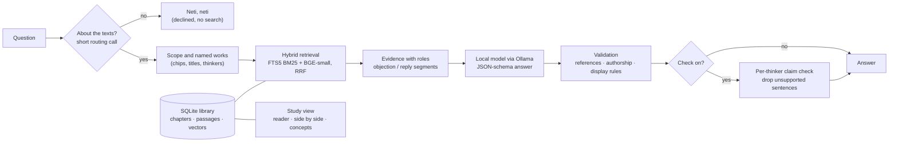
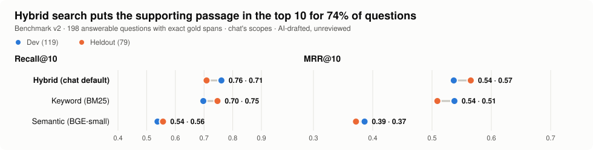
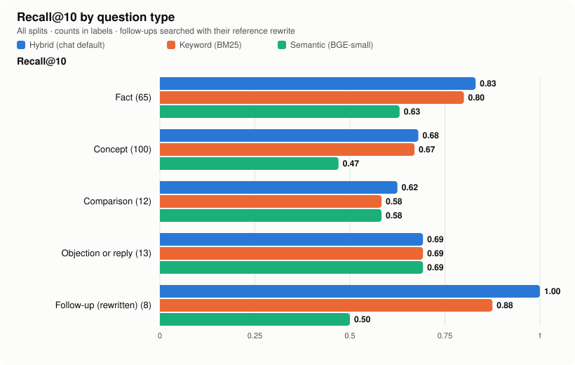
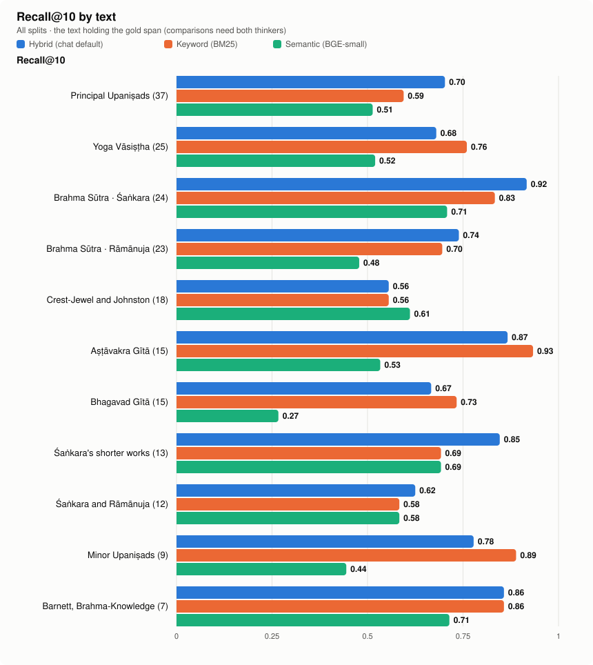
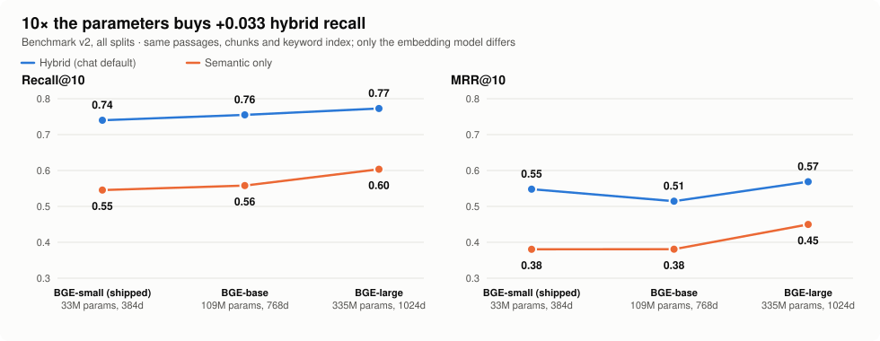

# Pramana

**Ask the Upaniṣads, Śaṅkara and Rāmānuja, on your own machine.**

Pramana (_pramāṇa_, a means of valid knowledge) is a local study companion for Advaita
Vedānta. It answers questions from a library of public-domain translations of the
Upaniṣads, the Bhagavad Gītā, the Brahma Sūtra commentaries of Śaṅkara and Rāmānuja,
and classic works of the tradition, using your own [Ollama](https://ollama.com/) model
(`gemma4:e4b` by default). Every answer is built from passages retrieved for that
question, and your questions and books stay on your computer: the only network use is
the explicit download commands.

**New here?** Start with [your first run, from a fresh clone](docs/guides/first-run.md).

| | |
| --- | --- |
| **Library** | 13 editions · 66 works · 2,639 chapters · 8,851 indexed passages · 12.3 million characters |
| **Commentaries side by side** | Śaṅkara (SBE 34/38) and Rāmānuja (SBE 48) on the Brahma Sūtra, matched page by page on printed adhyāya, pāda and sūtra |
| **Concepts** | 110-term Advaita glossary with IAST, Devanagari, meanings and concept pages |
| **Measured** | 214-question benchmark (v2) over every text, six question types, exact gold spans; three embedding models compared; off-topic routing measured |
| **Local** | SQLite FTS5 + pinned BGE-small embeddings + Ollama; no accounts, API keys or hosted services |
| **Tested** | 126 deterministic Python tests, 6 frontend tests, Markdown link checks, installed-wheel check |

## What you can do

**Ask (chat)**
- **Grounded answers.** Fresh hybrid retrieval for every question, follow-ups included;
  the model must answer from the supplied passages or say the library does not support
  an answer. Internal references are validated; the chat shows only the conversation.
- **Off-topic questions are declined.** "Reverse a linked list" shares words with some
  passage, so search alone cannot reject it; a short routing call does, before any
  search: *"Neti, neti: not this, not this. I give knowledge, but this is not the
  knowledge you seek…"*
- **Compare thinkers.** "How do Śaṅkara and Rāmānuja differ on…?" retrieves each author
  separately and shows one card per thinker. Every passage a view cites must be written
  by that thinker, or no answer is given.
- **Objections and replies.** Printed cues ("an objection is raised", "Not so, we reply",
  *pūrvapakṣa*/*siddhānta* headings) are passed to the model so an opponent's view is not
  read as the author's conclusion.
- **Scope, depth and modes.** Ask within the Upaniṣads, the Gītā, the Yoga Vāsiṣṭha,
  Śaṅkara or Rāmānuja; choose Brief / Explain / In depth; switch on **Vichāra** for guiding
  questions, or **Check** for a second pass that removes sentences the passages do not
  support.
- **Glossary cards.** Advaita terms in answers carry hover cards (IAST, Devanagari, meaning).

**Study (reader)**
- **Library and reader** with page marks, footnotes, marked objections and replies, and an
  argument outline per page.
- **Side by side:** Śaṅkara and Rāmānuja on any sūtra (`#/study/sutra/1/1/1`).
- **Concept pages:** where each group of texts discusses *adhyāsa*, *māyā*, *sākṣin*…
- **Passages behind an answer**, **search**, and **reading paths** such as "First steps
  in Advaita".

## How it works



Texts enter through explicit, resumable importers that pin what they fetch (SHA-256),
keep the origin, rights statement and attribution on every record, and publish only after
the whole edition validates. Offsets are Python code points into immutable chapter text,
so every passage, highlight and benchmark span can be traced back exactly.

## The library

All Vedānta sources are public domain as each source states; details, exclusions and
measured parse results are in the [source notices](docs/notices/sources.md).

| Texts | Translation | `--source` | Works | Chapters | Passages | Characters |
| --- | --- | --- | ---: | ---: | ---: | ---: |
| Brahma Sūtra with Śaṅkara's commentary | Thibaut, SBE 34 and 38 | `brahma-sutra` | 1 | 552 | 1,243 | 1,671,949 |
| Brahma Sūtra with Rāmānuja's Śrībhāṣya | Thibaut, SBE 48 | `sribhashya` | 1 | 571 | 1,230 | 1,603,866 |
| Chāndogya, Kena, Īśa, Kauṣītaki, Aitareya Āraṇyaka | Max Müller, SBE 1 | `upanishads-1` | 5 | 222 | 350 | 348,994 |
| Kaṭha, Muṇḍaka, Taittirīya, Bṛhadāraṇyaka, Śvetāśvatara, Praśna, Maitrāyaṇa | Max Müller, SBE 15 | `upanishads-2` | 7 | 108 | 298 | 350,012 |
| Thirty Minor Upaniṣads | Narayanasvami Aiyar, 1914 | `minor-upanishads` | 30 | 30 | 372 | 527,475 |
| Vivekacūḍāmaṇi, Ātma Bodha, Tattva Bodha and other works | Charles Johnston, 1946 | `crest-jewel` | 8 | 17 | 117 | 180,648 |
| _Knowledge of Self_, _Direct Realisation_ and six more works attributed to Śaṅkara | Venkataramanan, 1921 | `shankara-works` | 8 | 8 | 94 | 139,705 |
| Bhagavad Gītā with commentary | Swami Swarupananda, 1909 | `gita-swarupananda` | 1 | 18 | 83 | 111,243 |
| _Brahma-Knowledge_ | L. D. Barnett, 1911 | `brahma-knowledge` | 1 | 42 | 95 | 118,007 |
| Aṣṭāvakra Gītā (_The Heart of Awareness_) | John Richards, 1996 | `ashtavakra-gita` | 1 | 20 | 38 | 47,668 |
| Vivekacūḍāmaṇi (verses' English and notes; OCRed scan) | Swami Madhavananda, 1921 | `vivekachudamani` | 1 | 252 | 252 | 191,945 |
| **Yoga Vāsiṣṭha** (opt-in) | Vihari-Lala Mitra, 1891–99 | `yoga-vasistha` | 1 | 673 | 4,092 | 6,175,179 |
| Vishnu Purana | H. H. Wilson, 1840 | `vishnu-purana` | 1 | 126 | 587 | 846,941 |
| **Total** | | | **66** | **2,639** | **8,851** | **12,313,632** |

`--source advaita` fetches every Vedānta source except two. The Yoga Vāsiṣṭha is
opt-in: it is larger than the rest of the library together and measurably crowds other
passages out (below), so chat's **All texts** leaves it out unless you choose its scope
or name it. Swami Madhavananda's 1921 Vivekacūḍāmaṇi exists only as a scan, so
`--source vivekachudamani` OCRs it locally with [Chandra OCR](docs/guides/corpus.md) on
an NVIDIA GPU (71 minutes for 252 pages on an RTX 5070 Ti); its English is kept and its
Sanskrit verses left out, because too many Devanagari words were misread. Three private PDFs (Chinmayananda's
_Holy Geeta_, Śaṅkara's Gītā commentary translated by Alladi Mahadeva Sastry, and the
Taittirīya Ānanda-valli) can be added locally and are never distributed.

## Benchmarks

Measured on 23 October 2026 on the library above, with the pinned `BAAI/bge-small-en-v1.5`
embedding model and 384/448-token chunks. Retrieval benchmarks measure whether the right
passage reaches the model, not whether the answer is correct. **Every question was
drafted by an AI model and none is human-reviewed yet**, so these are engineering
diagnostics, not validated measurements. The full breakdown, every failure and how to
rerun: [benchmarks/advaita/v2](benchmarks/advaita/v2/README.md).

### Benchmark v2: 214 questions over every text

<picture>
  <source media="(prefers-color-scheme: dark)" srcset="docs/images/benchmarks/v2-overview-dark.svg">
  
</picture>

| Method | Dev R@10 | Dev MRR@10 | Heldout R@10 | Heldout MRR@10 | All R@10 |
| --- | ---: | ---: | ---: | ---: | ---: |
| **Hybrid** (chat default) | **0.761** | **0.537** | 0.709 | **0.565** | **0.740** |
| Keyword (BM25) | 0.697 | 0.538 | **0.747** | 0.509 | 0.717 |
| Semantic (BGE-small) | 0.538 | 0.386 | 0.557 | 0.372 | 0.545 |

198 answerable questions (119 dev, 79 heldout, split frozen at creation) plus 16
out-of-corpus probes. They cover all eleven text groups and are tagged **fact** (65),
**concept** (100), **comparison** (12: Śaṅkara and Rāmānuja on the same sūtra; both
thinkers' spans needed), **objection** (13), **follow-up** (8, with history and a reference
rewrite) and **out of corpus** (16). The 50 v1 questions are kept unchanged inside v2.

**Read with care:** the 148 new questions were written from exact sentences, and their
wording is closer to the text than v1's. On the same index they score hybrid R@10 0.780
against 0.620 for the v1 questions (keyword 0.770 against 0.560). So v2's overall
numbers are not comparable with v1's, and the v1 subset remains the continuity measure.

<picture>
  <source media="(prefers-color-scheme: dark)" srcset="docs/images/benchmarks/v2-by-type-dark.svg">
  
</picture>

- **Comparisons are hardest** (hybrid 0.62): the top 10 held both thinkers' spans for 4
  of 12, one thinker's for 7 and neither for 1. Chat searches each thinker separately,
  which this retrieval benchmark does not imitate.
- **Follow-ups need the rewrite:** searched as typed ("How does Ramanuja respond to that
  idea?") they reach R@10 0.625; with the reference standalone rewrite, 1.000. Chat
  rewrites follow-ups with the model before searching.
- **Failures** (55 for hybrid): the gold is at ranks 11–50 in 34 and outside the top 50
  in 21. The top hit was another work in 30, the right work but another chapter in 17,
  and the right chapter but another passage in 8. No gold span is split across two
  indexed passages.

<picture>
  <source media="(prefers-color-scheme: dark)" srcset="docs/images/benchmarks/v2-by-text-dark.svg">
  
</picture>

Semantic search alone is weakest on the Gītā (0.27) and the minor Upaniṣads (0.44). The
Crest-Jewel is the one group where it beats keyword search (0.61 against 0.56), perhaps
because Johnston's English ("vestures", "the Eternal") rarely shares the asker's words.

### Embedding models

<picture>
  <source media="(prefers-color-scheme: dark)" srcset="docs/images/benchmarks/models-dark.svg">
  
</picture>

| Model | Parameters | Dims | Semantic R@10 | Semantic MRR@10 | Hybrid R@10 | Hybrid MRR@10 | Embed 8,851 passages (GPU) |
| --- | ---: | ---: | ---: | ---: | ---: | ---: | ---: |
| **BGE-small** (shipped) | 33M | 384 | 0.545 | 0.380 | 0.740 | 0.548 | 22 s |
| BGE-base | 109M | 768 | 0.558 | 0.381 | 0.755 | 0.515 | 34 s |
| BGE-large | 335M | 1024 | **0.604** | **0.450** | **0.773** | **0.569** | 103 s |

Each model re-embedded the same stored passages in its own copy of the library, so
chunks and keyword search are identical and only the embedding model differs
([`scripts/compare_embeddings.py`](scripts/compare_embeddings.py); candidates download
only with `--download`). BGE-large is best on every measure (hybrid R@10 +0.033, MRR
+0.021); BGE-base gains a little recall but ranks worse. The shipped model is
unchanged: a switch needs a rebuild of every index, ten times the parameters on CPU, and
a check on reviewed questions first.

### Off-topic routing

Before searching, one short call to the local model asks whether the question is about
the texts at all (about 0.1 s). On the v2 set, 196 of 198 answerable questions route to
the texts, and all 7 clearly off-topic probes (code, trivia, recipes) are declined, as
are 3 of 4 questions about other traditions' scriptures. Near-domain works that are not
in the library (Nāgārjuna, Abhinavagupta) mostly route to the texts, where the answer
step's evidence-based refusal applies. **The routing prompt was chosen by comparing four
variants on this same set**, so these numbers are tuned, not held out
([routing.json](benchmarks/advaita/v2/routing.json)).

### v1: the frozen 50 questions

<picture>
  <source media="(prefers-color-scheme: dark)" srcset="docs/images/benchmarks/passage-dark.svg">
  
</picture>

| Method | Dev R@10 | Dev MRR@10 | Heldout R@10 | Heldout MRR@10 |
| --- | ---: | ---: | ---: | ---: |
| **Hybrid** (chat default) | **0.600** | 0.404 | **0.650** | **0.515** |
| Keyword (BM25) | 0.567 | **0.409** | 0.550 | 0.351 |
| Semantic (BGE-small) | 0.400 | 0.336 | 0.450 | 0.333 |

The original 50 questions (30 dev, 20 heldout), unchanged since creation. Details:
[benchmarks/advaita](benchmarks/advaita/README.md).

### Library growth

<picture>
  <source media="(prefers-color-scheme: dark)" srcset="docs/images/benchmarks/library-growth-dark.svg">
  
</picture>

Adding the Crest-Jewel and the Aṣṭāvakra Gītā left recall unchanged. Searching the Yoga
Vāsiṣṭha as well took 16 of the 150 top-3 slots across the 50 questions and lowered
hybrid recall (dev 0.633 → 0.600, heldout 0.750 → 0.650); excluding it from "All texts"
restores dev (0.667). Adding Madhavananda's Vivekacūḍāmaṇi (252 pages, part of "All
texts") lowered dev again to 0.600: three questions left the hybrid top 10 (Uddālaka's
"thou art it", the Kaṭha chariot, Rāmānuja's world as Brahman's body) and one entered.
Its pages took the top keyword slots for "Is the Self ever born or does it die?" and
pushed the Kaṭha chariot passage out of the keyword top 50. Its notes discuss the same
Upaniṣad and Gītā teachings, and the gold is a single passage, so a relevant passage
from another text counts as a miss. BM25 word statistics cover the whole index, so any import also
shifts keyword ranking.

### Chapter benchmark (Vishnu Purana)

<picture>
  <source media="(prefers-color-scheme: dark)" srcset="docs/images/benchmarks/chapter-dark.svg">
  
</picture>

| Method | v0.1 R@10 | v0.1 MRR@10 | Today R@10 | Today MRR@10 |
| --- | ---: | ---: | ---: | ---: |
| Hybrid | 95% | 0.8250 | 95% | 0.8238 |
| Keyword | 90% | 0.7406 | 95% | 0.7375 |
| Semantic | 100% | 0.8026 | 100% | 0.8026 |

20 development-visible questions with chapter-level labels, filtered to Wilson's edition.
The v0.1 index held 587 passages and today's holds 8,599, so keyword runs are not
directly comparable. See [benchmarks/README.md](benchmarks/README.md).

### Spelling tolerance

<picture>
  <source media="(prefers-color-scheme: dark)" srcset="docs/images/benchmarks/spelling-dark.svg">
  
</picture>

The Sacred Books of the East write *Khândogya*, *Pragâpati*, *Nakiketas*; readers type
Chandogya, Prajapati, Naciketas. Query words absent from the index borrow indexed
spellings with the same phonetic key. The feature changes nothing on either frozen
benchmark; on a four-question diagnostic set written afterwards it lifts keyword MRR@10
from 0.65 to 1.00. Four questions are too few to generalise from.

### What was tried and did not help

| Change | Result on the dev split | Kept? |
| --- | --- | --- |
| Weighting keyword over semantic results in fusion (12 settings) | every setting within one question of the current one | No |
| Search expansion for the 87 new glossary terms | hybrid MRR 0.412 → 0.397, keyword 0.396 → 0.362 | Display-only |
| Searching the Yoga Vāsiṣṭha by default | hybrid R@10 0.633 → 0.600 | Opt-in |
| BGE-base instead of BGE-small (all of v2) | hybrid R@10 0.740 → 0.755, MRR 0.548 → 0.515 | No |
| Asking the answer model to classify off-topic questions inside its answer | all 4 programming questions still answered | Replaced by a routing call |

### Answers with the real model

Diagnostic review of individual answers with `gemma4:e4b`, not a measured accuracy
([full notes](docs/verification/verification.md)):

| Question | Outcome |
| --- | --- |
| How does Śaṅkara define superimposition? | Grounded in BS I.1.1; matches the "apparent presentation" definition and its examples |
| Śaṅkara and Rāmānuja on the individual soul | Both views correctly attributed |
| Śaṅkara and Rāmānuja on whether the world is real | First run inverted Rāmānuja (he restates the Advaita view to refute it); after per-thinker checks, name-free retrieval and prompt guidance, runs were correct or refused |
| What does Ashtavakra tell Janaka about bondage and liberation? | Grounded in chapters 8 and 10 |
| What does the Yoga Vasishtha say about the mind creating the world? | Grounded in books 2 and 5 |
| The Kaṭha Upaniṣad on the Self (vichāra) | Answered from the Kaṭha itself, with three reflective questions |
| Madhavananda's Vivekacūḍāmaṇi: the three rare things | Grounded in that edition's page 10 (human birth, longing for liberation, a sage's care) |
| "Reverse a linked list", "What is the duty of a software engineer?" | Answered from unrelated passages before routing; now declined ("Neti, neti…") |

## Quickstart

Requires Python 3.12 with [uv](https://docs.astral.sh/uv/), Node.js 22.12+, and Ollama with
`gemma4:e4b` pulled. The [first-run guide](docs/guides/first-run.md) explains each step,
expected times and disk use, and what to do when something fails.

```sh
uv sync --locked && npm --prefix web ci && npm --prefix web run build
uv run pramana model setup                       # pinned embedding model, once (~130 MB)
uv run pramana corpus download --source advaita  # about 15 minutes at a polite page rate
for f in .pramana/corpora/*/chapters.jsonl; do uv run pramana ingest "$f"; done
uv run pramana index                             # a few minutes on CPU
uv run pramana serve                             # http://127.0.0.1:8000
```

## Limits

Pramana checks that answers cite passages they were given and that each thinker's view
cites that thinker's own text. It does **not** verify that a reading is correct. The model
can misread an argument, especially where a commentator restates a rival view at length
without a printed cue, and the optional check is the same model judging itself. The
benchmark questions are unreviewed, and the answer-level evaluation
(`pramana evaluate-answers`, about 1–2 hours of GPU time) has not been run on v2 yet. Treat answers as a starting point for reading the
texts, which the Study view keeps one click away.

## Documentation

Everything is indexed in [docs/](docs/README.md): the [first run](docs/guides/first-run.md),
[building the library](docs/guides/corpus.md), [chat and answers](docs/guides/chat.md), the
[HTTP API](docs/reference/api.md), [source notices](docs/notices/sources.md) and
[verification](docs/verification/verification.md). Plans: the [roadmap](ROADMAP.md), the
[UX plan](docs/plans/ux.md) and the [hosted plan](docs/plans/hosted-deployment.md), a free
public site with public-domain texts only (not deployed).

The benchmark charts are generated from the result files by `scripts/plot_benchmarks.py`;
`scripts/benchmark_report.py` writes a self-contained HTML report with every table and
failure to `.pramana/reports/benchmark.html`.

## License

Code: [Apache 2.0](LICENSE). Source texts and model weights keep their own terms; the SBE
Brahma Sūtra editions and the Crest-Jewel permit non-commercial use only. Private PDFs,
OCR output and extracted text are **not distributed**.
