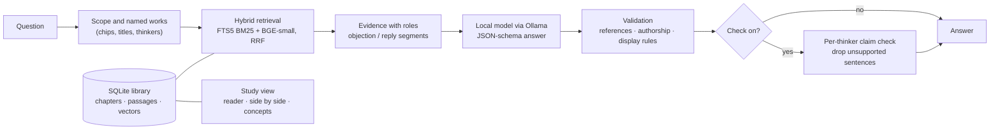
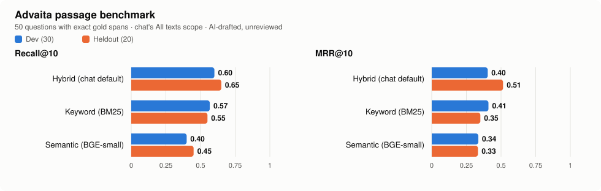
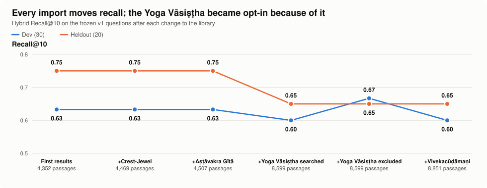
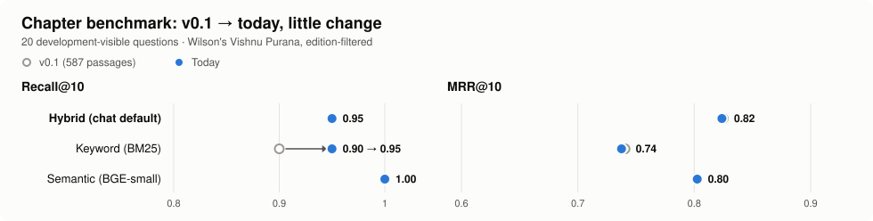
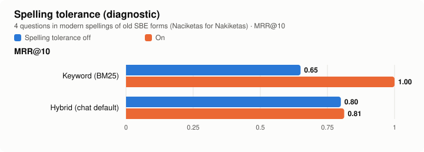

# Pramana

**Ask the Upaniṣads, Śaṅkara and Rāmānuja, on your own machine.**

Pramana (_pramāṇa_, a means of valid knowledge) is a local study companion for Advaita
Vedānta. It answers questions from a library of public-domain translations of the
Upaniṣads, the Bhagavad Gītā, the Brahma Sūtra commentaries of Śaṅkara and Rāmānuja,
and classic works of the tradition, using your own [Ollama](https://ollama.com/) model
(`gemma4:e4b` by default). Every answer is built from passages retrieved for that
question, and your questions and books stay on your computer: the only network use is
the explicit download commands.

**New here?** Start with [your first run, from a fresh clone](docs/guides/first-run.md).

| | |
| --- | --- |
| **Library** | 12 editions · 65 works · 2,387 chapters · 8,599 indexed passages · 12.1 million characters |
| **Commentaries side by side** | Śaṅkara (SBE 34/38) and Rāmānuja (SBE 48) on the Brahma Sūtra, matched page by page on printed adhyāya, pāda and sūtra |
| **Concepts** | 110-term Advaita glossary with IAST, Devanagari, meanings and concept pages |
| **Measured** | 50-question passage benchmark with exact gold spans, a chapter benchmark, and recorded real-model sessions |
| **Local** | SQLite FTS5 + pinned BGE-small embeddings + Ollama; no accounts, API keys or hosted services |
| **Tested** | 120 deterministic Python tests, 6 frontend tests, Markdown link checks, installed-wheel check |

## What you can do

**Ask (chat)**
- **Grounded answers.** Fresh hybrid retrieval for every question, follow-ups included;
  the model must answer from the supplied passages or say the library does not support
  an answer. Internal references are validated; the chat shows only the conversation.
- **Compare thinkers.** "How do Śaṅkara and Rāmānuja differ on…?" retrieves each author
  separately and shows one card per thinker. Every passage a view cites must be written
  by that thinker, or no answer is given.
- **Objections and replies.** Printed cues ("an objection is raised", "Not so, we reply",
  *pūrvapakṣa*/*siddhānta* headings) are passed to the model so an opponent's view is not
  read as the author's conclusion.
- **Scope, depth and modes.** Ask within the Upaniṣads, the Gītā, the Yoga Vāsiṣṭha,
  Śaṅkara or Rāmānuja; choose Brief / Explain / In depth; switch on **Vichāra** for guiding
  questions, or **Check** for a second pass that removes sentences the passages do not
  support.
- **Glossary cards.** Advaita terms in answers carry hover cards (IAST, Devanagari, meaning).

**Study (reader)**
- **Library and reader** with page marks, footnotes, marked objections and replies, and an
  argument outline per page.
- **Side by side:** Śaṅkara and Rāmānuja on any sūtra (`#/study/sutra/1/1/1`).
- **Concept pages:** where each group of texts discusses *adhyāsa*, *māyā*, *sākṣin*…
- **Passages behind an answer**, **search**, and **reading paths** such as "First steps
  in Advaita".

## How it works



Texts enter through explicit, resumable importers that pin what they fetch (SHA-256),
keep the origin, rights statement and attribution on every record, and publish only after
the whole edition validates. Offsets are Python code points into immutable chapter text,
so every passage, highlight and benchmark span can be traced back exactly.

## The library

All Vedānta sources are public domain as each source states; details, exclusions and
measured parse results are in the [source notices](docs/notices/sources.md).

| Texts | Translation | `--source` | Works | Chapters | Passages | Characters |
| --- | --- | --- | ---: | ---: | ---: | ---: |
| Brahma Sūtra with Śaṅkara's commentary | Thibaut, SBE 34 and 38 | `brahma-sutra` | 1 | 552 | 1,243 | 1,671,949 |
| Brahma Sūtra with Rāmānuja's Śrībhāṣya | Thibaut, SBE 48 | `sribhashya` | 1 | 571 | 1,230 | 1,603,866 |
| Chāndogya, Kena, Īśa, Kauṣītaki, Aitareya Āraṇyaka | Max Müller, SBE 1 | `upanishads-1` | 5 | 222 | 350 | 348,994 |
| Kaṭha, Muṇḍaka, Taittirīya, Bṛhadāraṇyaka, Śvetāśvatara, Praśna, Maitrāyaṇa | Max Müller, SBE 15 | `upanishads-2` | 7 | 108 | 298 | 350,012 |
| Thirty Minor Upaniṣads | Narayanasvami Aiyar, 1914 | `minor-upanishads` | 30 | 30 | 372 | 527,475 |
| Vivekacūḍāmaṇi, Ātma Bodha, Tattva Bodha and other works | Charles Johnston, 1946 | `crest-jewel` | 8 | 17 | 117 | 180,648 |
| _Knowledge of Self_, _Direct Realisation_ and six more works attributed to Śaṅkara | Venkataramanan, 1921 | `shankara-works` | 8 | 8 | 94 | 139,705 |
| Bhagavad Gītā with commentary | Swami Swarupananda, 1909 | `gita-swarupananda` | 1 | 18 | 83 | 111,243 |
| _Brahma-Knowledge_ | L. D. Barnett, 1911 | `brahma-knowledge` | 1 | 42 | 95 | 118,007 |
| Aṣṭāvakra Gītā (_The Heart of Awareness_) | John Richards, 1996 | `ashtavakra-gita` | 1 | 20 | 38 | 47,668 |
| **Yoga Vāsiṣṭha** (opt-in) | Vihari-Lala Mitra, 1891–99 | `yoga-vasistha` | 1 | 673 | 4,092 | 6,177,442 |
| Vishnu Purana | H. H. Wilson, 1840 | `vishnu-purana` | 1 | 126 | 587 | 846,941 |
| **Total** | | | **65** | **2,387** | **8,599** | **12,123,950** |

`--source advaita` fetches every Vedānta source except the Yoga Vāsiṣṭha. That one is
opt-in: it is larger than the rest of the library together and measurably crowds other
passages out (below), so chat's **All texts** leaves it out unless you choose its scope
or name it. Swami Madhavananda's 1921 Vivekacūḍāmaṇi is being added from a public-domain
scan with local [Chandra OCR](docs/guides/corpus.md). Three private PDFs (Chinmayananda's
_Holy Geeta_, Śaṅkara's Gītā commentary translated by Alladi Mahadeva Sastry, and the
Taittirīya Ānanda-valli) can be added locally and are never distributed.

## Benchmarks

Measured on 23 October 2026 on the library above, with the pinned `BAAI/bge-small-en-v1.5`
embedding model and 384/448-token chunks. These measure **retrieval**, whether the right
passage reaches the model, not whether the answer is correct.

### Passage level: does search find the exact supporting text?

<picture>
  <source media="(prefers-color-scheme: dark)" srcset="docs/images/benchmarks/passage-dark.svg">
  
</picture>

| Method | Dev R@10 | Dev MRR@10 | Heldout R@10 | Heldout MRR@10 |
| --- | ---: | ---: | ---: | ---: |
| **Hybrid** (chat default) | **0.667** | **0.412** | **0.650** | **0.533** |
| Keyword (BM25) | 0.567 | 0.396 | 0.650 | 0.369 |
| Semantic (BGE-small) | 0.400 | 0.339 | 0.450 | 0.333 |

50 questions across the Upaniṣads, both Brahma Sūtra commentaries, the Gītā, Śaṅkara's
select works and more. Each has exact gold spans (code-point offsets) that a retrieved
passage must contain in full; the split was frozen at creation (30 dev, 20 heldout).
**The questions were drafted by an AI model and are unreviewed**, so these are
engineering diagnostics, not validated measurements. Semantic search alone is clearly
weakest: in an earlier run, only 6 of its 29 misses had even the right chapter in the
top 10. Scope: chat's "All texts". Details: [benchmarks/advaita](benchmarks/advaita/README.md).

### Library growth and the opt-in Yoga Vāsiṣṭha

<picture>
  <source media="(prefers-color-scheme: dark)" srcset="docs/images/benchmarks/library-growth-dark.svg">
  
</picture>

Adding the Crest-Jewel and the Aṣṭāvakra Gītā left recall unchanged. Searching the Yoga
Vāsiṣṭha as well took 16 of the 150 top-3 slots across the 50 questions and lowered
hybrid recall (dev 0.633 → 0.600, heldout 0.750 → 0.650). Excluding it from "All texts"
restores dev (0.667) but not heldout (0.650): BM25 word statistics are computed over the
whole index, so importing a large work shifts keyword ranking even when it is filtered out.

### Chapter benchmark (Vishnu Purana)

<picture>
  <source media="(prefers-color-scheme: dark)" srcset="docs/images/benchmarks/chapter-dark.svg">
  
</picture>

| Method | v0.1 R@10 | v0.1 MRR@10 | Today R@10 | Today MRR@10 |
| --- | ---: | ---: | ---: | ---: |
| Hybrid | 95% | 0.8250 | 95% | 0.8238 |
| Keyword | 90% | 0.7406 | 95% | 0.7375 |
| Semantic | 100% | 0.8026 | 100% | 0.8026 |

20 development-visible questions with chapter-level labels, filtered to Wilson's edition.
The v0.1 index held 587 passages and today's holds 8,599, so keyword runs are not
directly comparable. See [benchmarks/README.md](benchmarks/README.md).

### Spelling tolerance

<picture>
  <source media="(prefers-color-scheme: dark)" srcset="docs/images/benchmarks/spelling-dark.svg">
  
</picture>

The Sacred Books of the East write *Khândogya*, *Pragâpati*, *Nakiketas*; readers type
Chandogya, Prajapati, Naciketas. Query words absent from the index borrow indexed
spellings with the same phonetic key. The feature changes nothing on either frozen
benchmark; on a four-question diagnostic set written afterwards it lifts keyword MRR@10
from 0.65 to 1.00. Four questions are too few to generalise from.

### What was tried and did not help

| Change | Result on the dev split | Kept? |
| --- | --- | --- |
| Weighting keyword over semantic results in fusion (12 settings) | every setting within one question of the current one | No |
| Search expansion for the 87 new glossary terms | hybrid MRR 0.412 → 0.397, keyword 0.396 → 0.362 | Display-only |
| Searching the Yoga Vāsiṣṭha by default | hybrid R@10 0.633 → 0.600 | Opt-in |

### Answers with the real model

Diagnostic review of individual answers with `gemma4:e4b`, not a measured accuracy
([full notes](docs/verification/verification.md)):

| Question | Outcome |
| --- | --- |
| How does Śaṅkara define superimposition? | Grounded in BS I.1.1; matches the "apparent presentation" definition and its examples |
| Śaṅkara and Rāmānuja on the individual soul | Both views correctly attributed |
| Śaṅkara and Rāmānuja on whether the world is real | First run inverted Rāmānuja (he restates the Advaita view to refute it); after per-thinker checks, name-free retrieval and prompt guidance, runs were correct or refused |
| What does Ashtavakra tell Janaka about bondage and liberation? | Grounded in chapters 8 and 10 |
| What does the Yoga Vasishtha say about the mind creating the world? | Grounded in books 2 and 5 |
| The Kaṭha Upaniṣad on the Self (vichāra) | Answered from the Kaṭha itself, with three reflective questions |

## Quickstart

Requires Python 3.12 with [uv](https://docs.astral.sh/uv/), Node.js 22.12+, and Ollama with
`gemma4:e4b` pulled. The [first-run guide](docs/guides/first-run.md) explains each step,
expected times and disk use, and what to do when something fails.

```sh
uv sync --locked && npm --prefix web ci && npm --prefix web run build
uv run pramana model setup                       # pinned embedding model, once (~130 MB)
uv run pramana corpus download --source advaita  # about 15 minutes at a polite page rate
for f in .pramana/corpora/*/chapters.jsonl; do uv run pramana ingest "$f"; done
uv run pramana index                             # a few minutes on CPU
uv run pramana serve                             # http://127.0.0.1:8000
```

## Limits

Pramana checks that answers cite passages they were given and that each thinker's view
cites that thinker's own text. It does **not** verify that a reading is correct. The model
can misread an argument, especially where a commentator restates a rival view at length
without a printed cue, and the optional check is the same model judging itself. The
benchmark questions are unreviewed. Treat answers as a starting point for reading the
texts, which the Study view keeps one click away.

## Documentation

Everything is indexed in [docs/](docs/README.md): the [first run](docs/guides/first-run.md),
[building the library](docs/guides/corpus.md), [chat and answers](docs/guides/chat.md), the
[HTTP API](docs/reference/api.md), [source notices](docs/notices/sources.md) and
[verification](docs/verification/verification.md). Plans: the [roadmap](ROADMAP.md), the
[UX plan](docs/plans/ux.md) and the [hosted plan](docs/plans/hosted-deployment.md), a free
public site with public-domain texts only (not deployed).

The benchmark charts are generated from the result files by `scripts/plot_benchmarks.py`.

## License

Code: [Apache 2.0](LICENSE). Source texts and model weights keep their own terms; the SBE
Brahma Sūtra editions and the Crest-Jewel permit non-commercial use only. Private PDFs,
OCR output and extracted text are **not distributed**.
