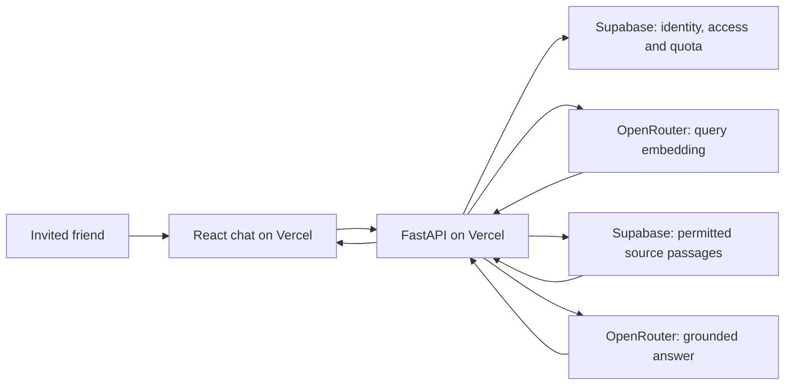

# Pramana: Vercel deployment plan

Status: **plan only; implement later, after 3 PM.** No application changes,
provider accounts, purchases, uploads, or deployments are part of this document.
Prepared on 14 October 2026; recheck provider prices and limits when implementing.

## Recommended first release

Build an **invite-only website for a small group of friends**, with a maximum of
**100 admitted questions per day across the whole website**. Keep the existing
local application working separately.

Use three services:

| Service    | Responsibility                                                                   |
| ---------- | -------------------------------------------------------------------------------- |
| Vercel     | Host the existing React website and a lightweight Python/FastAPI API.            |
| OpenRouter | Provide hosted answer generation and query embeddings.                           |
| Supabase   | Store the hosted corpus/index, handle sign-in, and enforce durable usage limits. |

Friends open the website, sign in, and ask questions. They do not install Python,
Ollama, or models. Your laptop can be switched off.

This adds a hosted deployment mode; it does not require rewriting the frontend
in Next.js or removing the local Python library/CLI.

## Why the local model does not move to Vercel

`localhost:11434` inside a Vercel function would refer to that function's own
machine, not your laptop. The installed `gemma4:e4b` model is approximately 9.6 GB;
do not plan to run that Ollama daemon inside this deployment. Vercel documents
bounded function memory, duration, and bundle sizes. Use functions to orchestrate
hosted inference instead. This is an architectural recommendation based on those
constraints, not a claim that every kind of model inference is impossible there.
[Vercel function limits](https://vercel.com/docs/functions/limitations)

Switching only the answer model is insufficient: the current retriever also loads
Sentence Transformers/BGE locally, and the current SQLite store initializes and
writes local files. Both need a hosted-mode solution. Vercel's filesystem is not
a shared persistent database for serverless instances.
[Vercel storage guidance](https://vercel.com/kb/guide/is-sqlite-supported-in-vercel)

Do not expose your laptop's Ollama endpoint through a public tunnel for this release.
OpenRouter supplies the cloud model; Ollama remains available in local mode.

## Defaults to start with

These are proposed product limits, not claims about any provider's free allowance.

| Setting                    | Initial choice                                                              |
| -------------------------- | --------------------------------------------------------------------------- |
| Audience                   | Approximately 5–10 invited friends; no anonymous chat                       |
| App-wide daily cap         | 100 admitted questions total                                                |
| Per-person daily cap       | 20 questions, also subject to the shared 100                                |
| Daily reset                | Midnight Asia/Kolkata, using the database clock                             |
| Burst limit                | 3 questions per minute per person                                           |
| Concurrent work            | 1 active question per person; 5 globally, with expiring leases              |
| Answer length              | Usually 1–3 short paragraphs; maximum 800 generated tokens                  |
| Model choice               | One explicitly selected, inexpensive paid chat model                        |
| Provider calls             | At most one rewrite, one query embedding, and two answer calls per question |
| Initial AI spending policy | Proposed $1/day and $10/month ceilings; configure before inviting users     |
| Conversations              | Current browser tab only; no server-side transcript storage                 |
| Initial shared corpus      | Wilson Vishnu Purana; exclude the three private PDFs                        |

The daily question count and monetary budget are separate ceilings. A monetary
limit or provider outage may stop service before 100 questions. Infrastructure
charges are separate from AI token charges. Do not promise the site will be free.

## 1. Set the hosted corpus boundary

- [ ] Create an explicit publication manifest containing approved document/edition
      identities, checksums, attribution, and rights notes.
- [ ] Begin with Wilson's Vishnu Purana and review its existing source notice for
      this hosted use. The local baseline is 126 chapters and 587 passages for that edition.
- [ ] Exclude all three supplied PDFs, their extracted text, and their embeddings
      from cloud exports by default. A private source folder or hidden citations
      does not establish permission to process/share its contents through a hosted service.
- [ ] Add a separate recorded decision before hosting any supplied commentary:
      rights to the intended use, permitted audience, and permission for third-party processing.
- [ ] Keep the complete four-work local library unchanged. Cloud exports must be
      generated from an allowlist, not by uploading the existing `.pramana/` directory.
- [ ] Change hosted suggested questions to match the books actually available there.
      Gita/Taittiriya questions should not imply those editions are hosted initially.

Chinmaya Mission's published policy reserves rights in its digital material.
The existing source notices and PDF guide record the other editions' unresolved
redistribution status. [Publisher policy](https://eshop.chinmayamission.com/page/copyright-policy)

**Done when:** an export audit finds only permitted source records; no private PDF,
OCR output, or private-book vectors appear in deployment artifacts or cloud uploads.

## 2. Select cloud models before rebuilding retrieval

- [ ] Add an `OpenRouterProvider` implementing the existing `AnswerProvider` interface.
      Use its server-side chat-completion endpoint and structured output when supported.
- [ ] Evaluate 2–3 currently available, inexpensive chat models. Select one by
      source-grounded answer quality, latency, schema reliability, privacy policy,
      and cost. Do not assume the local Ollama model tag exists on OpenRouter.
- [ ] Test unsupported questions and commentary objections/replies. Preserve the
      recorded comparison failure as a regression case, using synthetic material
      where private text is not permitted for hosted testing.
- [ ] Choose a hosted embedding model from OpenRouter's actual embedding catalog.
      Pin its model ID, dimensions, provider policy, and document/query instructions.
- [ ] Rebuild the **cloud** vectors with that embedding model. Never compare its
      query vectors against the existing BGE vectors, even if dimensions happen to match.
- [ ] Record tokenizer/chunking settings, index version, model identity, and any
      unavailable revision guarantees. Preserve canonical Unicode/source identities;
      document changed passage IDs when chunk boundaries change.
- [ ] Reject incompatible vectors/indexes instead of switching models silently.
      Keep local BGE indexes separate and working.
- [ ] Disable automatic fallback to unapproved models/providers. Do not use a random
      free-model router as the default for a shared service.

OpenRouter exposes separate [chat](https://openrouter.ai/docs/api/api-reference/chat/create-a-chat-completion)
and [embedding](https://openrouter.ai/docs/api/api-reference/embeddings/submit-an-embedding-request)
endpoints and an [embedding model catalog](https://openrouter.ai/docs/api/api-reference/embeddings/list-embeddings-models).
Its provider policies differ: disable training where supported, select acceptable
retention policies, and fail clearly if no permitted route is available.
[Provider policies](https://openrouter.ai/docs/guides/privacy/provider-logging)

**Done when:** one approved model pair works against fixtures, actual approved
sources, and insufficient-evidence questions; source-reference validation still holds.

## 3. Add a hosted retrieval adapter in Supabase

- [ ] Create versioned tables for corpus metadata, chapters, passages, embeddings,
      and publication status. Retain citations, offsets, authors, content types, and editions.
- [ ] Add PostgreSQL full-text search plus pgvector cosine retrieval, fusing 50
      candidates per method with the existing RRF approach. Apply publication and
      source/edition filters inside each query before selecting candidates.
- [ ] For this small corpus, start with exact vector search. Add approximate indexes
      only if measurements justify them and filtered recall is tested.
- [ ] Label PostgreSQL lexical scores accurately: its full-text ranking is not the
      existing SQLite BM25 implementation. Publish a separate hosted retrieval baseline.
- [ ] Separate source-catalog access from SQLite SQL. In particular,
      `Answerer._documents()` currently reads SQLite directly; replace that assumption
      with a catalog/retrieval interface usable by both local and hosted stores.
- [ ] Import from a local admin script, validate complete data and vectors, then
      atomically select a published index version. Keep the previous version for rollback.
- [ ] Use authenticated server-side database/RPC access. Browser roles must not
      directly read corpus tables, write embeddings, modify invitations, or change quotas.
- [ ] Restrict function execution grants and apply RLS where appropriate. Any
      privileged Supabase server key must remain server-only; RLS cannot compensate
      for an endpoint that exposes privileged operations.

Supabase documents [hybrid retrieval](https://supabase.com/docs/guides/ai/hybrid-search)
and [row-level security](https://supabase.com/docs/guides/database/postgres/row-level-security).

**Done when:** the hosted adapter returns traceable passages only from the published
allowlist, preserves offsets, and passes its separately recorded retrieval evaluation.

## 4. Make access genuinely invitation-only

- [ ] Use Supabase Auth with Google sign-in initially, assuming the invited group
      has Google accounts. Keep an owner-managed allowlist of verified emails/users.
- [ ] Configure Google OAuth consent/test users, Supabase callback settings, and
      exact production/local redirect URLs. Test with someone outside your own account.
- [ ] Verify the session server-side and check the active allowlist on every chat
      request. Signing in successfully must not itself grant application access.
- [ ] Deny uninvited or revoked users before retrieval, embeddings, or paid generation.
      Closing/reopening the browser must not create a new quota identity.
- [ ] Keep admin actions in scripts/dashboard initially: add/revoke a friend, inspect
      aggregate usage, pause chat. A custom admin website can wait.
- [ ] Protect hosted search, context, status details, and diagnostic endpoints too.
      Keep detailed provenance available through owner-authorized APIs, while ordinary
      chat responses expose only answer/status/request ID/quota information.
- [ ] Keep browser conversations in sessionStorage; clear them on sign-out as well
      as New chat. Do not store chat text in the usage database.

[Supabase Google sign-in](https://supabase.com/docs/guides/auth/social-login/auth-google)
provides the standard authentication flow. If email magic links are preferred later,
configure custom SMTP first: Supabase's default mail service is restricted to project
team addresses and is not suitable for sending login emails to arbitrary friends.
[SMTP requirements](https://supabase.com/docs/guides/auth/auth-smtp)

**Done when:** an invited friend can sign in and chat; an authenticated uninvited
person and a revoked person cannot access any paid/data endpoint.

## 5. Enforce 100 questions per day correctly

Use a transactional Supabase admission function, not browser storage, a Python
dictionary, or the current per-process semaphore. Vercel instances do not share
those counters or locks.

- [ ] Maintain daily global/user counters, short-window counters, expiring in-flight
      leases, and request records with unique `(user_id, request_id)` identities.
- [ ] In one transaction, validate membership, check limits/budget, reserve a slot,
      and increment admission counters. Concurrent requests must not exceed 100.
- [ ] Bind request IDs to a server-calculated payload hash and corpus version.
      Reusing an ID with different content is rejected; duplicate IDs never start
      a second model operation. Retain status metadata, not transcripts/responses.
- [ ] Count one admitted user question as one question, including a follow-up.
      Rewrite, embedding, and a bounded repair are internal operations, not extra
      user questions, but all their costs belong in the budget ledger.
- [ ] Reject invalid/unauthorized requests without consuming a question. Once an
      upstream operation starts, failed, cancelled, or timed-out work still counts.
      Refund only when the server can establish that no upstream work began.
- [ ] A manual retry after a completed/failed attempt uses a new request ID and
      consumes another question. New chat never resets usage.
- [ ] Fail closed if the quota service is unavailable: no paid calls without admission.
- [ ] Return 429 and reset time when a count limit is reached. Show a simple
      “Daily limit reached; try again after …” message and remaining personal quota.
- [ ] Seed global usage at 99 and race valid requests from several invited users:
      exactly one remaining daily admission can succeed. Separately test admission
      through 100 questions in completed batches, then reject the 101st before any
      model call. Cover per-user/burst limits, midnight rollover, duplicates,
      revoked access, crashed instances, and lease expiration.

**Done when:** limits hold across concurrent function instances and redeployments,
not just one local browser session.

## 6. Add independent spending controls

- [ ] Create a dedicated, limited OpenRouter application key; never expose it in
      frontend code or a `VITE_*` environment variable. No management key in the app.
- [ ] Set a small prepaid balance, disable automatic top-ups, and configure supported
      per-key spending limits. Keep indexing credentials/budget separate from live chat.
- [ ] Implement daily/monthly application budget reservations before upstream work,
      allowing for rewrite, embedding, answer, and the one permitted repair. Reconcile
      reservations with reported usage; retain conservative reservations for uncertain costs.
- [ ] Cap prompt/history size and output/reasoning tokens. Browser callers cannot
      select a different model, larger token allowance, plugins, or unlimited retries.
- [ ] Start with a 90-second overall request deadline; derive each upstream timeout
      from remaining time. Bound retry behavior and respect rate-limit responses.
- [ ] Record usage/cost, model, latency, status, and request IDs without logging
      prompts, retrieved text, auth tokens, or API keys by default.
- [ ] Add an owner kill switch. Configure Vercel/Supabase billing alerts and review
      their infrastructure limits separately from OpenRouter's AI spending limits.

OpenRouter's [credit, budget, and rate limits](https://openrouter.ai/docs/api_reference/limits)
are different controls. Its own free-model quotas do not implement this app's
100-question policy, and a follow-up can require multiple provider calls. Per-key
budget resets can use UTC while the app's daily question counter uses Asia/Kolkata;
show the correct reset for whichever limit was reached.

Estimate cost only after selecting models: multiply measured input/output tokens
for **all** calls by their current prices, add query embeddings, and include one-time
corpus embedding and infrastructure charges. The proposed dollar ceilings may
reduce available questions; they are limits, not a verified price forecast.

## 7. Prepare the Vercel runtime

- [ ] Keep React/TypeScript/Vite and the existing warm chat layout.
- [ ] Add a cloud app entrypoint that injects the hosted retriever and OpenRouter
      provider. Use one origin for frontend and `/api/*` where practical.
- [ ] Separate cloud dependencies from local ingestion/ML dependencies. The deployed
      API must not install/load PyTorch, Sentence Transformers, Ollama weights,
      Poppler, Tesseract, or local corpus files. Preserve an explicit local install path.
- [ ] Prove Vite asset serving and FastAPI routing in an early preview deployment
      before building the entire cloud adapter. Keep Python 3.12 and lock dependencies.
- [ ] Run OCR, source acquisition, chunking, and corpus embedding as explicit local
      admin jobs, never as request handlers or implicit Vercel builds.
- [ ] Scope production and preview secrets separately; previews use fixtures or
      a separate restricted dataset/key/quota. Do not give every preview production access.
- [ ] Verify Git and deployment exclusions for `.pramana/`, PDFs, OCR text, models,
      secrets, test reports containing source text, and local databases.
- [ ] Keep the UI free of source lists, passage identifiers, excerpts, and scores.
      Add sign-in/out, quota exhaustion, service errors, and a short privacy notice.
- [ ] Preserve pending, retry, cancellation, reload persistence, and New chat.
      Start with complete validated answers; streaming can wait so unvalidated
      partial output does not bypass evidence checks.

Vercel supports [FastAPI deployments](https://vercel.com/docs/frameworks/backend/fastapi)
and [Python 3.12 entrypoints](https://vercel.com/docs/functions/runtimes/python).
Current documented standard Python bundles are limited to 500 MB uncompressed;
keep this deployment comfortably smaller instead of relying on large-function beta.

Proposed server settings include `PRAMANA_MODE=cloud`, `OPENROUTER_API_KEY`, fixed
chat/embedding model IDs, Supabase URL/server credentials, published index version,
quota/budget settings, and the kill switch. Names/contracts should be finalized
when implementing. Only explicitly public Auth configuration belongs in the browser.

## 8. Launch in a small, reversible sequence

1. **Prepare accounts manually:** Vercel, OpenRouter, Supabase, and Google OAuth.
   Select deployment/database regions with latency and data handling in mind.
2. **Prove deployment:** deploy the existing chat shell and a lightweight fixture
   API to a preview URL; verify routes, build size, cold start, and error responses.
3. **Wire Auth/quota first:** prove that unauthenticated or over-limit traffic
   cannot reach a paid provider.
4. **Build the approved cloud index:** publish only allowed sources, then run
   hosted retrieval tests and verify rollback to the previous index version.
5. **Connect real models:** measure grounded answers, unsupported questions,
   structured output, request duration, and actual per-question cost.
6. **Test one external friend:** sign-in, a conversation/follow-up, daily-limit UI,
   mobile layout, cancellation, sign-out, and revoked access.
7. **Publish production:** use the generated `*.vercel.app` URL initially. A custom
   domain is optional. Set production Auth redirects to that exact address.
8. **Share manually with the first 2–3 allowlisted friends**, inspect usage for a
   day, and then expand the allowlist. No public signup or anonymous access yet.

This is an implementation order, not a promise to complete every step in one
afternoon. Do not connect paid production traffic before access and quota tests pass.

## Acceptance checklist before sharing

- [ ] Website works while the developer's laptop and Ollama are off.
- [ ] Only approved source editions exist in hosted storage and model requests.
- [ ] Invitations are enforced server-side on every relevant endpoint.
- [ ] The 101st global daily admission is rejected even under concurrency.
- [ ] Per-user limits survive reload, New chat, and new browser sessions.
- [ ] No paid calls occur during auth/quota/budget failure or after the kill switch.
- [ ] Input/output limits, bounded repair, cancellation, and timeout paths work.
- [ ] Cloud vectors match the selected embedding model and published index version.
- [ ] Retrieval results and answer quality are evaluated separately. The known
      objection/reply regression must produce a correct interpretation or admit
      insufficient evidence; a confident reversed conclusion blocks that model's
      release. Valid references alone are not a passing answer-quality test.
- [ ] Desktop/mobile chat and session persistence pass; source metadata stays out of the UI.
- [ ] Client bundles/logs contain no privileged keys or private source text.
- [ ] Users are told that questions, recent context, and retrieved excerpts are
      processed by hosted providers; no claim of fully local processing remains in hosted UI.
- [ ] Local CLI, SQLite/BGE retrieval, and Ollama mode still pass their regression checks.
- [ ] Deployment, rollback, key rotation, user revocation, cost review, and corpus
      publication are documented with verified commands.

## First task to implement after 3 PM

Create a cloud-mode deployment spike with **fixture data, Supabase sign-in and
atomic quota admission, plus a fake answer provider**. Deploy that to a Vercel
preview URL. Once it passes access and limit tests, add OpenRouter and the approved
corpus. This establishes the expensive/security-sensitive boundaries before inviting users.
