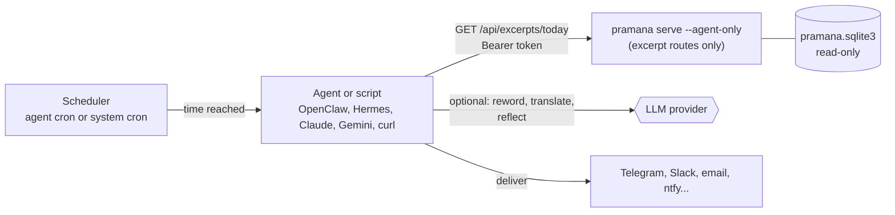

# Plan: an excerpt endpoint for agents and schedulers

Phases 1 to 3 are built (library, routes, command line, tests, allowlist, topic search) and
documented in a [setup guide](../guides/agent-excerpts.md); "explain this" and the MCP wrapper
are not. This plan adds a small, authenticated HTTP surface that returns **one excerpt of
what a text says**: a numbered verse, a short passage, or a single sentence. It can be random,
or the same excerpt for everyone on a given day, so that an AI agent or a plain scheduler can
deliver it at a time the user chooses. It is separate from the chat and the Study view and
does not change either.

## Decisions so far

| Question | Decision | Consequence |
| --- | --- | --- |
| Who triggers delivery? | **The caller pulls.** An agent's own scheduler, or system cron, calls the endpoint at the chosen time. | Pramana needs no scheduler, no timezone store and no outbound webhooks. A push scheduler can be added later (see [not in scope](#not-in-scope)). |
| What is returned? | **A verse, a passage or a sentence** (`kind`), not only numbered verses. | Prose texts become usable. Verse boundaries are printed; passage and sentence boundaries are computed and labelled so. |
| Which texts? | **Public-domain texts on a reviewed allowlist.** Brahma Sūtra commentaries are **not** in the default pool. | Private PDF editions and anything of uncertain rights never leave the server through this API. See [why commentaries stay out](#why-the-brahma-sutra-commentaries-stay-out). |
| Aṣṭāvakra Gītā, Aitareya Āraṇyaka, "Commentary on the Text" | **Included** (decided 1 November 2026). | The Aṣṭāvakra copy's provenance and the unidentified title are carried in the notes and `rights` lines below, not hidden. |
| How do agents reach Pramana? | **Private first** (decided 1 November 2026): the same machine, or a machine you own over a private network. A public URL stays a later option. | See [reaching Pramana](#reaching-pramana-from-an-agent). Hosted agents (claude.ai, Gemini apps, cloud routines) cannot reach `localhost`, so they wait for the public route. |
| Where does the assistant run, and which model? | **Hermes on a VPS beside Pramana, with a free LLM provider**; the daily message comes from Hermes' own scheduler so it can learn preferences (decided 1 November 2026) | Pramana stays stateless: preferences and sent IDs live in Hermes. See [Hermes on a VPS](../guides/agent-excerpts-vps.md). The free provider sees your chat; the excerpts are public domain. |
| REST or MCP? | **REST with an OpenAPI schema first.** MCP is an optional wrapper later. | For "give me an excerpt", MCP adds nothing REST cannot do: every agent below can call HTTP, run `curl` from a skill, or take a function definition. |

## What the repo's rules require

From [AGENTS.md](../../AGENTS.md); these shape the design more than any preference does.

- **Private text is never sent to a hosted service.** Claude, Gemini and most agent
  back-ends are hosted. Whatever this API returns must be safe to hand to them.
- **Provenance travels with the text.** Every excerpt carries edition, translator, source URL,
  rights statement and attribution. Different editions stay separate; the API never blends
  them.
- **Offsets are zero-based code-point intervals** `[start, end)` into the stored chapter text.
  An excerpt is a slice of a chapter and must equal that slice.
- **Do not guess boundaries or references.** A `verse` is returned only where the edition
  prints its number. A `passage` or `sentence` has a **derived** boundary (found by splitting
  sentences) and never carries a verse number; the response says `boundary: "derived"`.
- **Translation, commentary and `mixed` stay distinct** and are labelled in every response.
- **Objection and reply are marked only from explicit cues.** A lone sentence from an
  opponent's argument must not be served as the author's view (see
  [below](#why-the-brahma-sutra-commentaries-stay-out)).
- **Rights are "stated by the source", not legal advice.** The response repeats a reviewed
  statement; it does not assert more.
- **No accounts, no server-side conversation persistence.** The design is stateless. The
  daily excerpt is a pure function of date and seed, and "don't repeat" is carried by the
  caller.
- **Existing endpoints are local and unauthenticated** ([API reference](../reference/api.md)).
  The new routes are the first that may be reached from outside the machine, so they get their
  own authentication and their own server mode (below).

## Architecture



The LLM is optional and sits in the agent, not in Pramana. A scheduled `curl` can deliver an
excerpt with no model at all.

## What is an excerpt?

The index stores **chapters** and **passages** (chunks of about 384 tokens). An excerpt is a
smaller unit cut from a stored chapter, in one of three kinds:

| Kind | What it is | Boundary | Reference |
| --- | --- | --- | --- |
| `verse` | A numbered unit the edition prints: a verse, mantra or numbered stanza | **Printed** (its number) | Section plus printed number, e.g. `I, 2, 1` |
| `passage` | One to four whole, consecutive sentences from one paragraph, 150 to 600 characters | **Derived** | The chapter's printed section only; no number |
| `sentence` | One standalone sentence, 60 to 280 characters, that does not open with a connective or pronoun ("Thus", "He", "This") | **Derived** | The chapter's printed section only |

### Verses: three printed forms

Checked against the local index (66 documents, all with `Source.url`):

| Edition | Printed form | Parser |
| --- | --- | --- |
| Müller, Upaniṣads (SBE 1, 15), 12 documents; Swarupananda, Bhagavad Gītā (`mixed`) | Leading `1. `, some `3 .`, Gītā ranges `4-6.` | `leading-number` |
| Richards, Aṣṭāvakra Gītā | Trailing `2.1`, hard-wrapped lines; sometimes alone on its own line | `trailing-ref` |
| Venkataramanan, Select Works attributed to Śaṅkara | Trailing `(37)` or `(37).` | `trailing-paren` |

Not verse-numbered: the Thirty Minor Upaniṣads, Johnston's texts, Wilson, Barnett, Madhavananda.
Those can still supply passages and sentences. Yoga Vāsiṣṭha numbers its sections but not
with a sequence the verse rules accept (in the chapters read, the first section is unnumbered and
numbering starts at 2), so it is out until it has its own audited rule.

### Passages and sentences

Derived from a paragraph by splitting at sentence ends, guarding abbreviations ("i. e.",
"viz.", "&c.", "Vol."). A window is kept only when it starts with a capital or an opening
quote, ends at a sentence end, has balanced quotes and brackets, contains no scan marker, and
fits its length bounds. A `sentence` additionally must not begin with an anaphoric or
connective word and must not be a cross-reference ("see Sûtra III, 2, 4"). Both must be
**readable**: not a list of names (more than a quarter of the words capitalised, as in a
genealogy: "Pururavas had six sons, Ayus, Dhimat, Amavasu…") and not opening with an
all-caps word, which is a scan's small-caps chapter opening. Sentences are only as
self-contained as these rules can tell, so the
response can include the **paragraph around the excerpt** (`context=true`) for the agent to
show when a sentence needs it.

### Cautions seen in the data, each of which the extractors must handle or reject

- **A verse can span several paragraphs.** Taittirīya I, 4 verse 1 continues across blank lines
  until the next printed number. A verse runs to the next printed number, the rule that
  `_verse_extent` in [verses.py](../../src/pramana/verses.py) already uses.
- **Editions break sentences at verse numbers.** One Taittirīya verse ends "She brings near and
  spreads," and the sentence resumes after the next number. Units that do not end in terminal
  punctuation are rejected.
- **Scan artefacts.** Chāndogya I, 6 contains a stray `[paragraph continues]`. Canonical text is
  immutable, so units containing such markers are rejected, not cleaned.
- **Removed footnote anchors.** Double spaces such as "the road  that" suggest stripped
  footnote marks. The response returns the slice verbatim, with stored notes anchored inside it
  in `notes`.
- **Length bounds** are defaults with `min_chars` and `max_chars` overrides.

### Excerpt identity

```
excerpt_id = "<chapter_id>:<start>-<end>"      e.g.  ch_3f9a…:1204-1561
```

`chapter_id` is already stable and edition-scoped; `start`/`end` are the canonical
code-point offsets. The ID is readable, resolvable without a lookup table, and directly
usable as a [`Focus`](../reference/api.md#chat) for a later "explain this" call. If the
canonical text of a chapter ever changes, the ID stops resolving (404) instead of silently
pointing at different words.

### The pool is an allowlist

A committed file, `src/pramana/excerpt_sources.json`, like the existing `sayings.json`, lists
each document that may supply excerpts, with the kinds it may supply:

```json
[
  {"document_id": "katha-upanishad-sbe15", "label": "Kaṭha Upaniṣad",
   "kinds": {"verse": "leading-number"}, "cap": 300,
   "rights": "Public domain (published before 1923), as stated by Sacred Texts.",
   "attribution": "F. Max Müller, Sacred Books of the East vol. 15 (1884); digitized by Sacred Texts."},
  {"document_id": "vishnu-purana", "label": "Viṣṇu Purāṇa",
   "kinds": {"passage": "windows", "sentence": "windows"}, "cap": 300, "…": "…"}
]
```

Each entry carries its own short `rights` and `attribution` lines, written once in review. The
`Source.rights` strings stored with the chapters cannot be echoed: the audit found them
polluted with scraped page text ("… Next: Contents Sacred Texts | Hinduism « Previous: …
`(function(){function c(){…`").

Why an allowlist and not "every document whose rights text says public domain":

1. Rights statements are free text ("Stated by the source: …") and differ in strength. Whether
   one is good enough to redistribute is a human decision, recorded once, in review.
2. A new import can never leak into the pool by default.
3. At load time the pool additionally **refuses** any document whose `Source` has a
   `local_path`, and fails the build of the pool if one is listed. Private books cannot be
   added by a configuration mistake.

`cap` limits how many excerpts one document contributes (the ones with the smallest
`sha256(seed + id)`), so a very large text cannot swamp a small one: Yoga Vāsiṣṭha alone has
roughly 24,000 numbered paragraphs (a rough count) against the Gītā's 638 verses.

### Why the Brahma Sutra commentaries stay out

A random sentence from Śaṅkara's or Rāmānuja's commentary may be the **opponent's** argument,
and the commentator then refutes it. Measured on the local index: 89 of 400 candidate windows
in Śaṅkara's commentary and 75 of 355 in Rāmānuja's fall inside explicitly cued objection or
reply text, and uncued opponent views exist too (a sampled Rāmānuja "sentence", "The samavâya
is a relation, and if that relation is eternal…", is an objection). Served alone as "what the
text says", that misattributes the view, which AGENTS.md forbids. They can be added later as an
opt-in `include=commentary` that drops cued windows and attaches a `caution`; they are not part
of the default pool.

## API

All routes are under `/api/excerpts`, JSON, and need `Authorization: Bearer <token>`.
They return `404` until a token is configured (see [authentication](#authentication-and-exposure)).

| Method | Path | Purpose |
| --- | --- | --- |
| `GET` | `/api/excerpts/today` | The excerpt of the day: deterministic, identical for every caller on that date and seed |
| `GET` | `/api/excerpts/random` | A random excerpt, optionally excluding ones already sent |
| `GET` | `/api/excerpts/{excerpt_id}` | One excerpt by ID (for replays, or "show me that one again") |
| `GET` | `/api/excerpts/sources` | Documents in the pool, with counts per kind and their rights lines |

### Common query parameters

| Parameter | Applies to | Meaning |
| --- | --- | --- |
| `kind` | `today`, `random` | `verse`, `passage` or `sentence` (repeatable). Default: all three. |
| `document` | `today`, `random` | Restrict to one or more document IDs (repeatable). Must be in the pool. |
| `min_chars`, `max_chars` | `today`, `random` | Length bounds on the excerpt text. |
| `context` | all | `true` adds the paragraph around the excerpt and its position in it. |
| `format` | all | `json` (default), `text` or `markdown`: a ready-to-send message, so a script need not parse JSON. |
| `tz` | `today` | IANA zone that decides what "today" is (default `UTC`). Invalid names return 422. |
| `date` | `today` | `YYYY-MM-DD`, to preview or replay another day. |
| `seed` | `today` | Any string; different seeds give different, independent sequences (one per person, or per channel). |
| `exclude` | `random` | Excerpt IDs not to return (repeatable, at most 100). |
| `topic` | `random` | A word or phrase ("detachment"): an excerpt chosen from the best matches ([Phase 3](#phase-3-excerpts-about-a-topic-done)). |
| `strategy` | `random` with `topic` | `hybrid` (default; needs the local model and index) or `lexical` (keywords only) |

### Response (`format=json`)

```json
{
  "excerpt_id": "ch_3f9a…:1204-1561",
  "kind": "verse",
  "boundary": "printed",
  "text": "1. Death said: 'The good is one thing, the pleasant another; …'",
  "reference": "Kaṭha Upaniṣad, I, 2, 1",
  "document": "Katha Upanishad",
  "edition": "Sacred Books of the East, vol. 15",
  "translator": "F. Max Müller",
  "content_type": "translation",
  "language": "English",
  "source_url": "https://…",
  "rights": "Public domain (published before 1923), as stated by Sacred Texts.",
  "attribution": "F. Max Müller, Sacred Books of the East vol. 15 (1884); digitized by Sacred Texts.",
  "notes": [],
  "date": "2026-11-02",
  "pool": {"size": 1234, "version": "9c1e…"}
}
```

`text` is the excerpt exactly as stored, including a verse's printed number. The text is data:
there is no relevance score, no model-written summary and no confidence field, because none
exists and none is implied. `pool.version` is a hash of the pool's excerpt IDs, so a client can
tell when the daily sequence changed.

`format=text` returns the excerpt with whitespace runs collapsed, its reference and a one-line
attribution, for example:

```
“The good is one thing, the pleasant another; …”
— Kaṭha Upaniṣad I, 2, 1 (trans. F. Max Müller)
```

### How `today` stays stateless and non-repeating

1. Build the pool: the allowlisted documents' excerpts of the requested kinds, each document
   reduced to its `cap` smallest `sha256(seed + ":" + excerpt_id)`; sorted by that same hash.
2. The date's day number (days since 1970-01-01 in the requested `tz`) modulo the pool size
   picks the position.

Every agent asking on the same day gets the same excerpt, repeated calls are idempotent, and
nothing repeats until the whole pool has been used. Changing the allowlist, `cap` or `kind`
filter reorders the sequence; `pool.version` makes that visible, and a client that wants a
stable sequence should always pass the same `kind` and `seed`.

`random` is `secrets.choice` over the filtered pool and keeps no history. Callers that want
"no repeats" keep their own list and pass it as `exclude`; an agent with memory does this
naturally.

### Errors

| Status | When |
| --- | --- |
| `401` | Missing or wrong token |
| `404` | Excerpt routes not enabled (no token configured), or `excerpt_id` no longer resolves |
| `409` | Index `empty`, `stale` or `incompatible` (same actionable text as the other endpoints) |
| `422` | Bad parameter, or `document` not in the pool |
| `429` | Rate limit, with `Retry-After` |

Except `topic`, the routes read stored text only; they need neither Ollama nor the embedding
model. With `topic`, `409` also means the search index is missing or stale, or the local
embedding model is not set up (the message says which command to run); a topic that finds
nothing in the pool is `404`, and one with no letters is `422`.

## Authentication and exposure

- **Token.** `PRAMANA_AGENT_TOKEN` (at least 32 random characters; `pramana agent token`
  prints a fresh one). Compared in constant time. Several named tokens
  (`PRAMANA_AGENT_TOKENS=openclaw:…,claude:…`) allow revoking one agent without breaking the
  others. The server logs the token's name, never its value.
- **Off by default.** With no token configured the routes return `404`; installing the app
  does not open anything.
- **Rate limit.** In memory, per token (default 60 requests a minute). Counts and errors are
  logged; excerpts requested are not.
- **`pramana serve --agent-only`.** Starts the app with **only** `/api/excerpts/*` and the
  OpenAPI schema mounted. This is the process to put behind a tunnel or on the VPS. The normal
  app's `/api/search`, `/api/chat` and the Study endpoints are unauthenticated and serve the
  whole library, private editions included; **never expose the normal server** to a tunnel
  or a LAN you do not control. `--agent-only` also loads only allowlisted documents.
- **HTTPS.** Required for any non-loopback use. A tunnel or reverse proxy terminates TLS; the
  app still binds `127.0.0.1`.

## Reaching Pramana from an agent

| Where the agent runs | Route | Notes |
| --- | --- | --- |
| Same machine | `http://127.0.0.1:8000` | Simplest; the token still applies. |
| Another machine you own (home server, phone, VPS) | [Tailscale](https://tailscale.com) or WireGuard to the host | Nothing public; keep `--agent-only`. |
| Hosted agent or cloud routine (claude.ai, Gemini apps, scheduled cloud agents) | A public HTTPS URL: Cloudflare Tunnel, ngrok, or the [VPS plan](vps-hosting.md) | Cloud agents cannot see `localhost`. Use `--agent-only` and a strong token. |

**Decided: private first.** `pramana serve --agent-only` binds `127.0.0.1` only, as the rest of
the app does. A local agent (OpenClaw, Hermes, Claude Code, a cron job) calls it directly. For
an agent on another machine of yours, forward the port privately instead of binding a wider
address; Tailscale's `serve` command does this for a tailnet (check its documentation for the
current syntax). The token still applies on every route. Go public only for a hosted agent
that cannot run locally; that needs HTTPS and the steps in
[authentication and exposure](#authentication-and-exposure).

## Setting it up as a user

The step-by-step recipes (token, `--agent-only`, cron and ntfy, a systemd service, OpenClaw,
Hermes, Claude, Gemini and one tool definition for any LLM API) are in the
[setup guide](../guides/agent-excerpts.md), so that they live in one place. The guide records
which of them were tried and which were written only from each product's public documentation.

## Phase 0 results

Run on 1 November 2026 against the local index (66 documents, all with `Source.url`; the three
private PDFs are not in this index).

### Verses (a full audit)

Three extractors, one per printed form, were applied to every document that prints verse
numbers.

#### Rules the extractors ended up needing

- **`leading-number`**: a number at the start of a line, with an optional opening quote, an
  optional space before the dot (`3 .`) and ranges (`4-6.`). Numbers must run in sequence from
  1; a gap of one or two is allowed and recorded, never filled (Gītā 1.27 runs into 1.29: the
  print has no 28). A verse runs to the next number, then trailing paragraphs are dropped if
  they are speaker labels ("Sanjaya said:"), lead-ins ending in a colon ("…is this:--") or a
  chapter footer ("The end of chapter first…"). Those belong to the next verse or to nothing.
- **`trailing-ref`**: a paragraph ending in its reference (`2.1`); when the reference stands
  alone on a line, the paragraph before it is the verse.
- **`trailing-paren`**: a paragraph ending `(37)` or `(37).`, numbers in sequence from 1.
- A unit that starts in lower case after a page break is extended back to where its sentence
  starts, unless the previous paragraph ends with a full stop or a printed reference.
- **Rejected**, and counted: a `[paragraph continues]` marker (`marker`), under 40 characters
  (`short`), over 1,200 (`long`), no closing punctuation (`no-terminal`), or still starting in
  lower case (`lowercase-start`).

#### Per document

| Document | Units | Accepted | Rejected (reason) | Pool |
| --- | ---: | ---: | --- | --- |
| Bhagavad Gītā (Swarupananda, `mixed`) | 671 | 638 | 27 no-terminal, 6 marker | Include |
| Chāndogya | 595 | 524 | 53 no-terminal, 17 marker, 1 short | Include |
| Bṛhadāraṇyaka | 580 | 372 | 126 short, 58 no-terminal, 14 long, 10 marker | Include |
| Aitareya Āraṇyaka | 593 | 530 | 43 no-terminal, 11 short, 6 marker, 3 long | Include (decided); mostly ritual material |
| Kaṭha | 119 | 112 | 5 no-terminal, 2 marker | Include |
| Īśā | 18 | 17 | 1 marker | Include |
| Kena | 35 | 35 | none | Include |
| Muṇḍaka | 64 | 62 | 1 no-terminal, 1 marker | Include |
| Praśna | 67 | 55 | 10 no-terminal, 2 marker | Include |
| Śvetāśvatara | 113 | 106 | 5 no-terminal, 2 marker | Include |
| Kauṣītaki | 48 | 38 | 10 long | Include |
| Maitrāyaṇa | 71 | 48 | 13 long, 6 marker, 4 no-terminal | Include |
| Taittirīya | 29 | 23 | 5 no-terminal, 1 marker | Include (only 13 of 31 chapters print numbers) |
| Aṣṭāvakra Gītā (Richards) | 298 | 295 | 3 lowercase-start | Include (decided); provenance caveat below |
| Śaṅkara, Direct Realisation | 142 | 136 | 5 no-terminal, 1 marker | Include, "attributed to" |
| Śaṅkara, Definition of One's Own Self | 152 | 150 | 1 no-terminal, 1 marker | Include, "attributed to" |
| Śaṅkara, Century of Verses | 101 | 98 | 3 marker | Include, "attributed to" |
| Śaṅkara, Knowledge of Self | 68 | 68 | none | Include, "attributed to" |
| Śaṅkara, Hymn to Hari | 43 | 42 | 1 marker | Include, "attributed to" |
| Śaṅkara, Hymn to Dakṣiṇāmūrti | 10 | 9 | 1 marker | Include, "attributed to" |
| Śaṅkara, Ten-versed Hymn | 9 | 9 | none | Include, "attributed to" (its tenth verse is unnumbered in the print) |
| Śaṅkara, "Commentary on the Text" | 52 | 50 | 1 no-terminal, 1 lowercase-start | Include (decided) under its printed title; the edition does not say which work it is |

**3,417 verses** are accepted in these 22 documents, about 9 years of one verse a day. Median
length is 140 to 430 characters for most documents; Kauṣītaki (714) and Maitrāyaṇa (744) are
the longest.

### Passages and sentences (final counts, Phase 1)

The first-pass counts recorded here earlier (about 400 of each kind) were **wrong**: the
sentence splitter looked at the wrong slice, so abbreviations split sentences and almost every
sentence kept a trailing space. Phase 1 fixed it, added the readability rules, and counted
again on the real index:

| Text | Passages | Sentences | Median length |
| --- | ---: | ---: | ---: |
| Wilson, Viṣṇu Purāṇa (`cap` 300) | 932 | 2,197 | 171 |
| Johnston (8 documents) | 131 | 525 | 158 |
| Barnett, Brahma-Knowledge | 103 | 205 | 167 |
| Aiyar, Thirty Minor Upaniṣads (30 documents) | 805 | 1,392 | 157 |
| **Prose total** | **1,971** | **4,319** | |

With the 3,416 verses (3,417 audited, one refrain served once), the pool holds **9,706
excerpts**. The daily rotation applies the caps: **6,877 excerpts, about 18.8 years** of one a
day (3,416 verses, 1,131 passages, 2,330 sentences). The largest single document in it is the
Gītā, with 638.

Sampled by eye (18 random prose excerpts after the final rules), most read as complete
thoughts. Johnston's sentences are the best self-contained aphorisms. A Purāṇa or Barnett
sentence can depend on its story ("The other answered him, \"Who forsooth is he…"), which is
what `context=true` is for, and the Purāṇa's characters speak in their own voices, so an
excerpt is a quotation from the text, not a statement of doctrine.

### What was and was not checked

- **Mechanical, on all 3,367 verses accepted before "Commentary on the Text" was added:** no two
  overlap in a chapter; each begins with its own printed label; none contains scraped page
  chrome (URLs, "Sacred Texts", "Next:"). "Commentary on the Text" passed the same extractor
  with the rejection counts above but was not part of that check.
- **By eye:** about three random accepted verses per document and three rejected units per
  major reason; 18 random prose excerpts after the final rules. This is a sample, not a full
  read, and says nothing about translation quality.
- **Counts agree with the commonly cited totals** where I know them (Īśā 18, Kena 35,
  Muṇḍaka 64, Kaṭha 119, Aṣṭāvakra 298), from memory, not checked against the print editions.
- **Not audited:** Yoga Vāsiṣṭha (see above); the Brahma Sūtra windows beyond the role
  measurement. The rights lines were reviewed in Phase 1 (finding 10), by reading the stored
  statements, not by independent legal research.
- Units rejected as `no-terminal` are by design: they end in a semicolon, a colon or a comma
  because the sentence continues in the next verse.

### Findings that change the plan

1. **Stored rights text is polluted** with scraped page markup, so the API serves curated
   `rights` and `attribution` lines from the allowlist.
2. **380 accepted verses contain page-break blank lines** inside a sentence
   (`heart and\n\n\n\nmind`). `text` stays the exact slice; `format=text` and `markdown`
   collapse runs of whitespace. Aṣṭāvakra verses also carry hard line breaks about every 80
   characters.
3. **One identical text appears twice** (the refrain in Chāndogya VI). The pool keeps the first
   occurrence of any exact text.
4. **The `reference` string is built only from printed labels:** the chapter's printed section
   plus the verse label for Müller (`I, 2, 1`), chapter plus label for the Gītā (`2.19`), the
   label alone for Richards (`2.1`) and Venkataramanan (`37`); passages and sentences carry the
   printed section only.
5. **The Venkataramanan edition is titled "works attributed to Sankaracharya"**, while the
   stored author is "Sankaracharya". The allowlist attribution says "attributed to".
6. **Aṣṭāvakra Gītā provenance.** The public-domain dedication is quoted from the translator's
   own introduction ("presented to the public domain with his affection"), but the copy came
   from an archive.org upload "without uploader metadata". The allowlist `rights` line says so.
7. **"Public domain" is stated per source and, for the Gītā and Śaṅkara works, "in the US".**
   For a service reachable from other countries the API repeats the statement; it does not
   certify it.
8. **A very large text needs a cap**, or it dominates the rotation (the `cap` field). The
   Purāṇa alone would be about a third of the pool, so it is capped at 300.
9. **Commentaries need role handling**, so they are out of the default pool.
10. **Johnston's rights line carries a condition.** The source calls the 1946 text public domain
    in the US because the copyright was not renewed, and asks that the files be used for
    non-commercial purposes with its attribution notice intact. That is fine for private use;
    **review it before any public deployment.** Aiyar's stored rights text has a book dedication
    pasted into it, and Wilson's chapters record no sections (references read "Book 1,
    chapter 1"); the curated lines and the reference rule account for both.
11. **The Phase 1 splitter bug** (above) shows why the counts are recomputed by code, not
    carried over from exploratory scripts.

## Implementation phases

### Phase 0: audit the pool (done)

- [x] Verse extractors for the three printed forms, run over every document in the local index.
- [x] Rejected units counted by reason; samples read by eye; mechanical checks on offsets.
- [x] First pass of passage and sentence windows over the prose texts, and the
      objection/reply measurement on the Brahma Sūtra commentaries.
- [x] Decisions recorded: Aṣṭāvakra Gītā, Aitareya Āraṇyaka and "Commentary on the Text" in.

The audit scripts were exploratory and are **not committed**. Phase 1 writes the extractors
into `src/pramana/` with tests, so every number above can be reproduced from the code.

### Phase 1: library and routes (done)

- [x] `src/pramana/agent_excerpts.py`: the three verse parsers, the window rules, pool
      building (cached per corpus generation), `today`, `random`, by-ID lookup, formatting. No
      FastAPI imports, so it works from the CLI and tests.
- [x] `excerpt_sources.json` with `rights`, `attribution`, `kinds` and `cap` for every
      included document (62 documents in 9 groups), checked on load.
- [x] The window rules tuned and final counts recorded (above).
- [x] `src/pramana/agent_api.py`: the routes, token check, rate limit, `404` when disabled,
      and `create_agent_app` (used by `serve --agent-only`); `create_app` mounts the same routes.
- [x] `pramana serve --agent-only`, `pramana agent token`, `pramana excerpt today|random|sources`
      (the same output without HTTP).
- [x] Tests (35 new, deterministic, no models, books or network): the offsets (including a
      supplementary character), each verse parser on a fixture with a range, a gap, a lone
      trailing reference, a page break inside a sentence and a trailing speaker label; the
      sentence and window rules; `today` identical across calls and following date, seed and
      timezone; a full cycle visits every excerpt once and `cap` limits a document; a private or
      unlisted document never appears and listing one fails loudly; the committed allowlist is
      well formed and has no Brahma Sūtra commentary; `exclude`; unknown IDs; token off, wrong,
      and rate limit; the agent-only app mounts nothing else; the command line.
- [x] Checked live: `pramana serve --agent-only` with a real token on your index, called with
      `curl` (401 without a token, 404 for the normal app's routes, no token in the log).

Deviations from the plan above:

- **`409`** is returned only when no allowlisted text is imported. The routes read stored
  chapters, so a `stale` or `incompatible` search index does not affect them.
- **Logging**: the app's own logger records the token's name and the route; uvicorn's standard
  access log still prints request paths and query strings (such as `seed=`). Neither prints a
  token. Quieter logging is a one-line option if you want it.

### Phase 2: documentation

- [x] The endpoints in the [API reference](../reference/api.md) and an entry in the
      [docs index](../README.md).
- [x] The [setup guide](../guides/agent-excerpts.md). Its `curl`, cron-script and systemd-unit
      parts were run or verified here; the OpenClaw, Hermes, Claude, Gemini, ntfy and
      Tailscale parts were **not** tried against the real products, and the guide says so.
- [x] AGENTS.md: the architecture line and a new invariant for the allowlist, the token,
      `--agent-only`, derived boundaries and the excluded commentaries.
- [x] The [source notices](../notices/sources.md) say which editions feed the excerpt API and
      on what terms.

### Phase 3: excerpts about a topic (done)

You said the chatbot can already read the embeddings, so "a passage about detachment" reuses
them:

- [x] `GET /api/excerpts/random?topic=...` (and `pramana excerpt random --topic ...`): run the
      existing retriever over the **allowlisted documents only**, take the excerpts that lie
      wholly inside the top 12 hits' passages, rank those few against the topic, and choose at
      random among the best five. Excluded IDs, `kind`, `document` and length limits apply.
- [x] The embedding model is the one already set up (`pramana model setup`); nothing is
      downloaded, and a missing model or index is a `409` that names the command to run.
      `strategy=lexical` skips the model. Retrieval relevance is **not** returned and is not a
      statement that the text supports anything; the response only adds `topic` and `retrieval`.
- [x] Tests: ranking, the pool boundary (including that the search is restricted *before*
      ranking, so unlisted texts cannot crowd out the pool; the test fails if that is removed),
      exclusion, validation, a missing index, the agent-only app and the command line.
- [x] Tried on your index with the real model: three topics ("detachment from the fruits of
      action", "the nature of the Self", "fear of death") each returned an in-pool excerpt in
      4 to 7 seconds including the model load from the command line.

Limits worth knowing:

- An excerpt must lie wholly inside a retrieved passage (about 384 tokens). A verse that
  straddles two passages is not found by topic, though it is still served by `today`/`random`.
- The five best are chosen among at random, so the same topic can return different excerpts.
  I judged the three results above by eye only; there is no benchmark for topic quality, and
  the existing retrieval benchmarks do not measure it.
- `strategy=lexical` ranks by the number of shared words, which is crude.

### Phase 4: optional "explain this"

- [ ] `POST /api/excerpts/{excerpt_id}/explain`, which calls the existing answer pipeline with
      the excerpt as a `focus`. It needs the local model, so it is off in `--agent-only` unless
      one is configured; retrieved evidence may include other editions, and it is a separate
      route so that the plain excerpt routes never depend on a model.

### Phase 5: optional MCP wrapper

- [ ] A small stdio MCP server (`pramana mcp`) exposing `get_excerpt` with the same arguments,
      for clients that prefer tools they discover. It calls the same module as the routes.
      Build it only if a client you actually use needs it.

## Not in scope

- A built-in scheduler or push delivery (Telegram, email, webhooks). If the pull model proves
  tedious, add it as a separate phase: times and timezone in config, an outbound HTTPS POST
  with a retry and a timeout, and a delivery log without excerpt text.
- Private editions, and the Brahma Sūtra commentaries in the default pool (see above).
- Sanskrit or Devanagari text: the library holds English translations only, apart from four
  curated headwords in `sayings.json`.
- Per-user preferences, accounts or delivery history on the server.

## Open questions

1. **Do you want Yoga Vāsiṣṭha in the pool?** It is the largest text. It needs its own rule
   for its numbered sections and a `cap`, and it is a dialogue, so excerpts are quotations
   from the speakers in it.
2. **Should commentaries ever be available?** Only as an opt-in that drops cued objections and
   attaches a caution. The first version leaves them out.
3. **Default timezone.** `UTC` is neutral; a `PRAMANA_TZ` default would spare each caller
   from passing `tz`.
4. **Is the mix right?** Verses are about half of the daily rotation; prose sentences and
   passages the rest. A `kind` filter on each call changes it, but a different default (verses
   only, say) is a one-line change.
