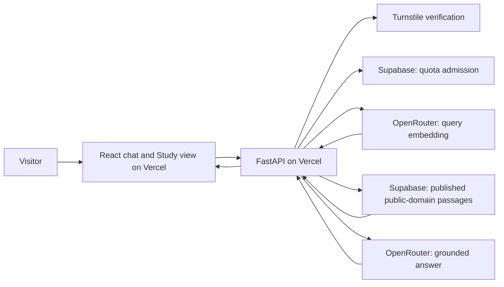

# Pramana: hosted public deployment plan

Status: **not deployed. A local spike of the access and quota guards exists**
([`hosted.py`](../../src/pramana/hosted.py); see [spike status](#spike-status)). No provider accounts, purchases, uploads, or
deployments are part of this document. First prepared on 14 October 2026 as an
invite-only plan; revised on 22 October 2026 for a public site now that a complete
public-domain Vedānta corpus exists. Recheck provider prices, limits and links
when implementing.

## Recommended first release

Build a **free, public website** where anyone can ask about the public-domain
Vedānta library, with a hard cap on admitted questions per day across the whole
site. Keep the local application (Ollama, private PDFs, SQLite/BGE) working
separately and unchanged.

| Service    | Responsibility                                                                |
| ---------- | ----------------------------------------------------------------------------- |
| Vercel     | Host the existing React website and a lightweight Python/FastAPI API.         |
| OpenRouter | Provide hosted answer generation and query embeddings.                        |
| Supabase   | Store the published corpus/index and enforce durable usage limits.            |
| Cloudflare Turnstile | Distinguish people from bots before any paid work, without accounts. |

**Free is a requirement, not a choice.** The Sacred Texts editions of Thibaut's
SBE 34, 38 and 48 permit "any non-commercial purpose" with their notice intact. The
hosted site therefore has no ads, paid tier, or sponsorship placement, and every
record keeps its recorded rights statement and attribution. Record this decision in
the [source notices](../notices/sources.md) before launch.

## Why the local model does not move to Vercel

`localhost:11434` inside a Vercel function would refer to that function's own
machine, not your laptop. The installed `gemma4:e4b` model is approximately 9.6 GB;
do not plan to run that Ollama daemon inside this deployment. Vercel documents
bounded function memory, duration, and bundle sizes. Use functions to orchestrate
hosted inference instead. This is an architectural recommendation based on those
constraints, not a claim that every kind of model inference is impossible there.
[Vercel function limits](https://vercel.com/docs/functions/limitations)

Switching only the answer model is insufficient: the current retriever also loads
Sentence Transformers/BGE locally, and the current SQLite store initializes and
writes local files. Both need a hosted-mode solution. Vercel's filesystem is not
a shared persistent database for serverless instances.
[Vercel storage guidance](https://vercel.com/kb/guide/is-sqlite-supported-in-vercel)

Do not expose your laptop's Ollama endpoint through a public tunnel for this release.
OpenRouter supplies the cloud model; Ollama remains available in local mode.

## Defaults to start with

These are proposed product limits, not claims about any provider's free allowance.

| Setting                    | Initial choice                                                              |
| -------------------------- | --------------------------------------------------------------------------- |
| Audience                   | Public; no accounts; Turnstile check before admission                       |
| App-wide daily cap         | 300 admitted questions total                                                |
| Per-visitor daily cap      | 10 questions per hashed IP (salted, rotated daily), within the global cap   |
| Daily reset                | Midnight UTC, using the database clock                                      |
| Burst limit                | 3 questions per minute per visitor                                          |
| Concurrent work            | 1 active question per visitor; 5 globally, with expiring leases             |
| Answer length              | Usually 1–3 short paragraphs; maximum 800 generated tokens                  |
| Model choice               | One explicitly selected, inexpensive paid chat model                        |
| Provider calls             | At most one rewrite, one query embedding, and two answer calls per question |
| Initial AI spending policy | Proposed $2/day and $30/month ceilings; configure before launch             |
| Conversations              | Current browser tab only; no server-side transcript storage                 |
| Shared corpus              | All `--source advaita` editions plus Wilson; never the private PDFs         |
| Without model budget       | Study view (reading and search) stays available; chat shows the reset time  |

The daily question count and monetary budget are separate ceilings. A monetary
limit or provider outage may stop chat before the question cap. Infrastructure
charges are separate from AI token charges. Hashed IPs are a coarse abuse control,
not identity: shared networks share a quota, and determined abuse is bounded by the
global cap and budget, not prevented.

## 1. Set the hosted corpus boundary

- [ ] Generate the export from an explicit allowlist: the `--source` manifests in
      `src/pramana/ingestion/` (`brahmasutra-manifest.json`,
      `sribhashya-manifest.json`, `sacredtexts/*.json`) plus Wilson's Vishnu Purana.
      Never upload the existing `.pramana/` directory.
- [ ] Require every exported record to carry a `Source.url` (not `local_path`), a
      checksum, and a rights statement that appears in the allowlist.
- [ ] Exclude all three supplied PDFs, their OCR/extracted text, and their
      embeddings. A hidden source list does not establish permission to process or
      share private text through hosted providers.
- [ ] Keep the complete local library unchanged.
- [ ] Use hosted suggested questions that match the hosted editions only (no
      Chinmayananda or Mahadeva Sastry examples).

**Done when:** an export audit finds only allowlisted public-domain records; no
private PDF, OCR output, `local_path` origin, or private-book vector appears in
deployment artifacts or cloud uploads.

## 2. Select cloud models before rebuilding retrieval

- [x] Add an `OpenRouterProvider` implementing the existing `AnswerProvider` interface
      (October 2026): chat completions with JSON-schema output, `:free` models only,
      private editions never sent. Query embeddings remain local.
- [ ] Evaluate 2–3 currently available, inexpensive chat models. Select one by
      source-grounded answer quality, latency, schema reliability, privacy policy,
      and cost. Do not assume the local Ollama model tag exists on OpenRouter.
- [ ] Test unsupported questions and commentary objections/replies. Preserve the
      recorded comparison failure as a regression case, using synthetic material
      where private text is not permitted for hosted testing.
- [ ] Choose a hosted embedding model from OpenRouter's actual embedding catalog.
      Pin its model ID, dimensions, provider policy, and document/query instructions.
- [ ] Rebuild the **cloud** vectors with that embedding model. Never compare its
      query vectors against the existing BGE vectors, even if dimensions happen to match.
- [ ] Record tokenizer/chunking settings, index version, model identity, and any
      unavailable revision guarantees. Preserve canonical Unicode/source identities;
      document changed passage IDs when chunk boundaries change.
- [ ] Reject incompatible vectors/indexes instead of switching models silently.
      Keep local BGE indexes separate and working.
- [ ] Disable automatic fallback to unapproved models/providers. Do not use a random
      free-model router as the default for a shared service.

OpenRouter exposes separate [chat](https://openrouter.ai/docs/api/api-reference/chat/create-a-chat-completion)
and [embedding](https://openrouter.ai/docs/api/api-reference/embeddings/submit-an-embedding-request)
endpoints and an [embedding model catalog](https://openrouter.ai/docs/api/api-reference/embeddings/list-embeddings-models).
Its provider policies differ: disable training where supported, select acceptable
retention policies, and fail clearly if no permitted route is available.
[Provider policies](https://openrouter.ai/docs/guides/privacy/provider-logging)

**Done when:** one approved model pair works against fixtures, actual approved
sources, and insufficient-evidence questions; source-reference validation still holds.

## 3. Add a hosted retrieval adapter in Supabase

- [ ] Create versioned tables for corpus metadata, chapters, passages, embeddings,
      and publication status. Retain citations, offsets, authors, content types, and editions.
- [ ] Add PostgreSQL full-text search plus pgvector cosine retrieval, fusing 50
      candidates per method with the existing RRF approach. Apply publication and
      source/edition filters inside each query before selecting candidates.
- [ ] For this small corpus, start with exact vector search. Add approximate indexes
      only if measurements justify them and filtered recall is tested.
- [ ] Label PostgreSQL lexical scores accurately: its full-text ranking is not the
      existing SQLite BM25 implementation. Publish a separate hosted retrieval baseline.
- [ ] Separate source-catalog access from SQLite SQL. In particular,
      `Answerer._documents()` currently reads SQLite directly; replace that assumption
      with a catalog/retrieval interface usable by both local and hosted stores.
- [ ] Import from a local admin script, validate complete data and vectors, then
      atomically select a published index version. Keep the previous version for rollback.
- [ ] Use authenticated server-side database/RPC access. Browser roles must not
      directly read corpus tables, write embeddings, modify invitations, or change quotas.
- [ ] Restrict function execution grants and apply RLS where appropriate. Any
      privileged Supabase server key must remain server-only; RLS cannot compensate
      for an endpoint that exposes privileged operations.

Supabase documents [hybrid retrieval](https://supabase.com/docs/guides/ai/hybrid-search)
and [row-level security](https://supabase.com/docs/guides/database/postgres/row-level-security).

**Done when:** the hosted adapter returns traceable passages only from the published
allowlist, preserves offsets, and passes its separately recorded retrieval evaluation.

## 4. Admit people, not bots, without accounts

- [ ] Verify a Cloudflare Turnstile token server-side on every chat request before
      retrieval, embeddings, or generation. Reject missing, reused, or failed tokens
      without consuming quota.
- [ ] Derive the visitor key as an HMAC of the client IP with a server secret
      rotated daily; store only that key, never raw IPs, cookies with identity, or
      chat text.
- [ ] Protect search and chapter endpoints with lighter, separate rate limits; they
      use no paid model but do use database capacity.
- [ ] Keep detailed provenance in API responses (the Study view needs it) but expose
      no status details, diagnostics, or administration endpoints publicly.
- [ ] Owner-only operations (kill switch, quota changes, corpus publication) run
      from scripts or the provider dashboards, not from the public app.

Optional later: sign-in for regular readers with a higher personal quota.

**Done when:** scripted requests without a valid Turnstile token never reach a paid
provider, and one visitor cannot exceed the per-visitor limits by reloading,
starting a new chat, or opening new tabs.

## 5. Enforce the daily question cap correctly

Use a transactional Supabase admission function, not browser storage, a Python
dictionary, or the current per-process semaphore. Vercel instances do not share
those counters or locks.

- [ ] Maintain daily global and per-visitor counters, short-window counters,
      expiring in-flight leases, and request records with unique request IDs.
- [ ] In one transaction, check limits and budget, reserve a slot, and increment
      admission counters. Concurrent requests must not exceed the global cap.
- [ ] Bind request IDs to a server-calculated payload hash and corpus version;
      duplicate IDs never start a second model operation. Retain status metadata,
      not transcripts or responses.
- [ ] Count one admitted question as one question, including a follow-up. Rewrite,
      embedding, and a bounded repair are internal operations whose costs still
      belong in the budget ledger.
- [ ] Reject invalid requests without consuming a question. Once upstream work
      starts, failed, cancelled, or timed-out work still counts.
- [ ] Fail closed if the quota service is unavailable: no paid calls without admission.
- [ ] Return 429 with the reset time; show "Today's questions are used up; reading
      and search still work. Chat resets at …".
- [ ] Seed global usage at cap − 1 and race valid requests: exactly one succeeds.
      Cover per-visitor and burst limits, midnight rollover, duplicates, crashed
      instances, and lease expiration.

**Done when:** limits hold across concurrent function instances and redeployments.

## 6. Add independent spending controls

- [ ] Create a dedicated, limited OpenRouter application key; never expose it in
      frontend code or a `VITE_*` environment variable. No management key in the app.
- [ ] Set a small prepaid balance, disable automatic top-ups, and configure supported
      per-key spending limits. Keep indexing credentials/budget separate from live chat.
- [ ] Implement daily/monthly application budget reservations before upstream work,
      allowing for rewrite, embedding, answer, and the one permitted repair. Reconcile
      reservations with reported usage; retain conservative reservations for uncertain costs.
- [ ] Cap prompt/history size and output/reasoning tokens. Browser callers cannot
      select a different model, larger token allowance, plugins, or unlimited retries.
- [ ] Start with a 90-second overall request deadline; derive each upstream timeout
      from remaining time. Bound retry behavior and respect rate-limit responses.
- [ ] Record usage/cost, model, latency, status, and request IDs without logging
      prompts, retrieved text, auth tokens, or API keys by default.
- [ ] Add an owner kill switch. Configure Vercel/Supabase billing alerts and review
      their infrastructure limits separately from OpenRouter's AI spending limits.

OpenRouter's [credit, budget, and rate limits](https://openrouter.ai/docs/api_reference/limits)
are different controls. Its own free-model quotas do not implement this app's
100-question policy, and a follow-up can require multiple provider calls. Per-key
budget resets can use UTC while the app's daily question counter uses Asia/Kolkata;
show the correct reset for whichever limit was reached.

Estimate cost only after selecting models: multiply measured input/output tokens
for **all** calls by their current prices, add query embeddings, and include one-time
corpus embedding and infrastructure charges. The proposed dollar ceilings may
reduce available questions; they are limits, not a verified price forecast.

## 7. Prepare the Vercel runtime

- [ ] Keep React/TypeScript/Vite and the existing warm chat layout.
- [ ] Add a cloud app entrypoint that injects the hosted retriever and OpenRouter
      provider. Use one origin for frontend and `/api/*` where practical.
- [ ] Separate cloud dependencies from local ingestion/ML dependencies. The deployed
      API must not install/load PyTorch, Sentence Transformers, Ollama weights,
      Poppler, Tesseract, or local corpus files. Preserve an explicit local install path.
- [ ] Prove Vite asset serving and FastAPI routing in an early preview deployment
      before building the entire cloud adapter. Keep Python 3.12 and lock dependencies.
- [ ] Run OCR, source acquisition, chunking, and corpus embedding as explicit local
      admin jobs, never as request handlers or implicit Vercel builds.
- [ ] Scope production and preview secrets separately; previews use fixtures or
      a separate restricted dataset/key/quota. Do not give every preview production access.
- [ ] Verify Git and deployment exclusions for `.pramana/`, PDFs, OCR text, models,
      secrets, test reports containing source text, and local databases.
- [ ] Keep the chat answers-only, as in local mode. Add quota exhaustion, service
      errors, a bot check, and a short privacy notice.
- [ ] Preserve pending, retry, cancellation, reload persistence, and New chat.
      Start with complete validated answers; streaming can wait so unvalidated
      partial output does not bypass evidence checks.

Vercel supports [FastAPI deployments](https://vercel.com/docs/frameworks/backend/fastapi)
and [Python 3.12 entrypoints](https://vercel.com/docs/functions/runtimes/python).
Current documented standard Python bundles are limited to 500 MB uncompressed;
keep this deployment comfortably smaller instead of relying on large-function beta.

Proposed server settings include `PRAMANA_MODE=cloud`, `OPENROUTER_API_KEY`, fixed
chat/embedding model IDs, Supabase URL/server credentials, published index version,
quota/budget settings, and the kill switch. Names/contracts should be finalized
when implementing. Only explicitly public Auth configuration belongs in the browser.

## 8. Launch in a small, reversible sequence

1. **Prepare accounts manually:** Vercel, OpenRouter, Supabase, and Cloudflare
   Turnstile. Choose regions with latency and data handling in mind.
2. **Prove deployment:** deploy the chat shell, Study view, and a fixture API to a
   preview URL; verify routes, build size, cold start, and error responses.
3. **Wire Turnstile and quota first:** prove bots and over-limit traffic cannot
   reach a paid provider.
4. **Publish the public-domain index:** export from the allowlist, run hosted
   retrieval tests, and verify rollback to the previous index version.
5. **Connect real models:** measure grounded answers, comparisons, unsupported
   questions, structured output, request duration, and actual per-question cost.
6. **Soft launch:** share the preview with a few readers, inspect aggregate usage
   and cost for several days, then publish on the `*.vercel.app` production URL.
   A custom domain is optional.

Do not connect paid production traffic before admission and quota tests pass.

## Acceptance checklist before launch

- [ ] The website works while the developer's laptop and Ollama are off.
- [ ] Only allowlisted public-domain editions exist in hosted storage and model requests.
- [ ] Each hosted record shows its rights statement and attribution in the Study view.
- [ ] Requests without valid Turnstile verification never reach a paid provider.
- [ ] The global cap holds under concurrency; per-visitor limits survive reloads,
      New chat, and new tabs.
- [ ] No paid calls occur during quota/budget failure or after the kill switch.
- [ ] Reading and search keep working when the model budget is exhausted.
- [ ] Input/output limits, bounded repair, cancellation, and timeout paths work.
- [ ] Cloud vectors match the selected embedding model and published index version.
- [ ] Retrieval and answer quality are evaluated separately; the known
      objection/reply regression must be interpreted correctly or produce an
      insufficient-evidence answer. Valid references alone do not pass.
- [ ] Comparisons still pass the per-thinker authorship check with the hosted model.
- [ ] Desktop/mobile chat and session persistence pass; chat shows no source metadata.
- [ ] Client bundles and logs contain no keys, raw IPs, prompts, or retrieved text.
- [ ] Visitors are told that questions, recent context, and retrieved excerpts are
      processed by hosted providers; hosted UI makes no claim of local processing.
- [ ] Local CLI, SQLite/BGE retrieval, and Ollama mode still pass their regression checks.
- [ ] The site has no advertising or paid features (non-commercial source terms).

## Spike status

Implemented locally on 23 October 2026, with no accounts or deployment:

- `create_app(hosted=HostedGuard(...))` checks every `/api/chat` and `/api/chat/stream`
  request before retrieval or any model call: Turnstile verification (server-side,
  fails closed if unreachable), then one immediate SQLite transaction that checks the
  kill switch, request-ID reuse (bound to a payload hash), per-visitor burst and daily
  limits, and the global daily cap, and only then records the admission. Refusals
  are 403/409/429/503 with `Retry-After` where it applies; nothing is counted for them.
- Visitors are an HMAC of the IP under a key rotated daily; raw IPs are not stored.
- `GET /api/config` exposes only whether hosting is on and the public site key; the
  browser loads the Turnstile widget only then, sends a single-use token and a fresh
  `X-Request-Id` per question, and resets the widget after each.
- Search, chapters and the Study view need no admission (separate rate limits remain
  to do). Local mode is unchanged.
- Tests cover limits, duplicates, day rollover, pausing, burst windows, key rotation,
  a 16-thread race for the last admission (exactly one succeeds), and that refused
  requests never reach the provider. `uv run python tests/manual_chat_server.py
  --hosted` runs the fixture app with Cloudflare's testing keys and a tiny quota.

Not done: the Supabase port of the admission transaction, budget reservations against
real model costs, the OpenRouter provider, the public-domain export, deployment, and
search rate limits.

## First implementation task

Create a cloud-mode spike with **fixture data, Turnstile verification, atomic quota
admission, and a fake answer provider**, deployed to a Vercel preview URL. Once it
passes admission and limit tests, add OpenRouter and the public-domain index.
