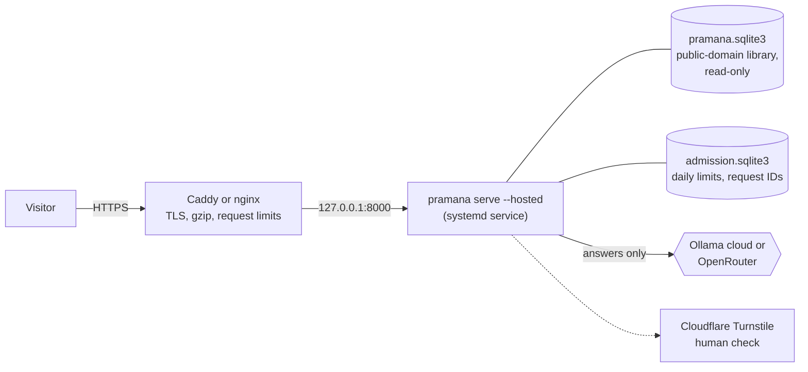

# Plan: a public Pramana on a VPS

A simpler route to a public site than the serverless [hosted deployment plan](hosted-deployment.md):
one small virtual server running the same app that runs locally. Not started; costs and
provider limits below must be rechecked before any purchase.

## The suggestion

A friend suggested:

> "yeah totally doable, using an ollama key and hosting it on my vps, embeddings can be
> stored in postgresql"

| Part | Assessment |
| --- | --- |
| **An Ollama key** | Works with little change. Ollama's cloud takes the same `POST /api/chat` at `https://ollama.com` with `Authorization: Bearer <key>`; Pramana's Ollama provider now sends `OLLAMA_API_KEY` when set (`PRAMANA_OLLAMA_URL=https://ollama.com`). A non-local Ollama counts as a hosted provider, so private books are never sent to it. Ollama documents its cloud limits in GPU time, with a free tier whose exact allowance it does not publish ([third-party summary](https://freellm.net/providers/ollama-cloud)); a public site needs a plan whose limits are known. |
| **A VPS** | A good fit. The app is one Python process plus one SQLite file; a server with no GPU suffices when answers come from a cloud model. It must sit behind a reverse proxy with HTTPS and the existing hosted-mode guards. |
| **Embeddings in PostgreSQL** | Not needed for this corpus. The library is about 9,000 passages and read-only once built; SQLite serves it in tens of milliseconds and can be copied to the server as one ~90 MB file. PostgreSQL with pgvector becomes worth its operation (a database server, migrations, backups) only with several app servers sharing one library, or a library a hundred times larger. See [is SQLite the right choice](#why-not-postgresql-yet). |

## Target architecture

- **Retrieval stays on the server**: BGE-small on the CPU (about 1 GB of memory with
  PyTorch), FTS5 and the vector scan as today.
- **Only answer writing leaves the server**, with the public-domain passages and the
  visitor's question.
- **No accounts and no stored conversations**, as locally: chat history stays in the
  visitor's tab; notes stay in their browser.

## Phases

### 1. Build the public library (on your machine)

- [ ] Add `pramana export --public OUT`: copy the library keeping only records with a
      `Source.url` from the `--source` manifests; exclude every `local_path` record (the
      three private PDFs) and their vectors. Fail if any private record would remain.
- [ ] Decide whether the opt-in Yoga Vāsiṣṭha is included (it is public domain; the
      Gutenberg licence asks that the trademark not be used, which records already
      respect).
- [ ] Build the index locally, run the benchmarks on the exported copy, and record the
      result as the hosted baseline.

**Done when:** an audit of the exported file finds no `local_path`, OCR output of a
private book, or private-edition vector.

### 2. Choose the answer model

- [ ] Compare Ollama cloud and OpenRouter on a sample of the v2 benchmark
      (`pramana evaluate-answers --limit 20`): expected outcome, gold passage cited,
      latency, and cost per question. One question makes two to three calls.
- [ ] A shared free tier will not carry a public site: OpenRouter's free plan allows 50
      requests a day per account, about 20 questions for everyone together. Budget a paid
      plan or keep the site invitation-only.
- [ ] Set a hard monthly spending cap at the provider, and the admission limits below it.

### 3. Wire hosted mode into `serve`

`src/pramana/hosted.py` already has the Turnstile check and atomic daily admission;
`pramana serve` does not yet enable them.

- [ ] `pramana serve --hosted`: read `PRAMANA_TURNSTILE_SECRET`, `PRAMANA_TURNSTILE_SITE_KEY`,
      `PRAMANA_ADMISSION_SECRET` and limits from the environment; refuse to start in hosted
      mode without them.
- [ ] Rate-limit search and chapter endpoints separately from chat (lighter limits).
- [ ] Refuse private-book features in hosted mode (the library has none, but check).
- [ ] Log no questions or answers; log only counts and errors.

### 4. Set up the server

- [ ] A Linux VPS with 2 vCPU and 4 GB of memory (BGE-small, FastAPI, the OS), about 10 GB
      of disk. Check current prices; no GPU is needed.
- [ ] Install `uv` and Node 22; clone, `uv sync --locked`, `npm --prefix web ci && npm
      --prefix web run build`; copy the exported library and the embedding model
      (`pramana model setup` once, or copy `.pramana/models/`).
- [ ] A `systemd` unit running `pramana serve --hosted` as an unprivileged user, bound to
      127.0.0.1; environment file with the secrets, readable only by that user.
- [ ] Caddy (automatic HTTPS) or nginx with Let's Encrypt in front; request-body and rate
      limits at the proxy too.
- [ ] Firewall: only ports 80 and 443 open; SSH by key.

### 5. Publish responsibly

- [ ] An "About these texts" page: every edition with its rights and attribution, the
      SBE editions' non-commercial terms, and that answers are model-written and
      unverified.
- [ ] A short privacy note: what is sent to the answer provider (the question and
      public-domain passages), nothing stored about visitors except an HMAC'd daily count.
- [ ] A pause switch (already in `Admission.set_paused`) exposed as an admin command.

### 6. Operate

- [ ] Update: `git pull`, `uv sync --locked`, rebuild the web app, restart the service.
- [ ] Library updates: export and index locally, copy the new file, restart (atomic: copy
      to a new name, then rename).
- [ ] Watch: provider spend, admission refusals, error rate. Nothing needs backing up: the
      library is rebuilt from sources, and admission data is disposable.

## Why not PostgreSQL yet

| | SQLite file (proposed) | PostgreSQL + pgvector |
| --- | --- | --- |
| Setup | copy one file | install, configure, migrate, back up |
| Keyword search | FTS5 with BM25, diacritics folded (measured on the benchmark) | `tsvector` ranking: different scores, needs re-benchmarking |
| Vector search at 9k passages | exact scan, about 65 ms | exact or approximate index; similar at this size |
| Several app servers | each needs its own copy (fine for read-only data) | one shared database |
| When it pays off | now | many servers, or a much larger library |

Revisit when either column's "when it pays off" applies; the retrieval code would then
need a second storage adapter, and both would have to pass the same benchmark.

## Running without any model

Even on a server, chat answers are optional: with no reachable model, the app reports
"Answers need a language model, and none is ready" in the chat, and a question opens
as a search in the Study view. Search, the reader, side by side, citations, concepts and
notes need only the library and the embedding model.
