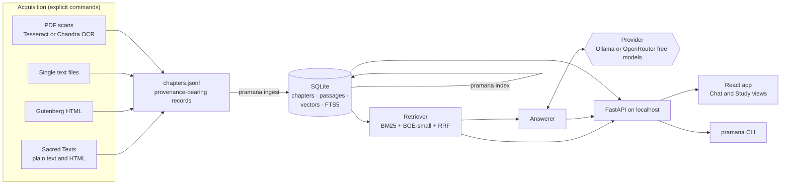
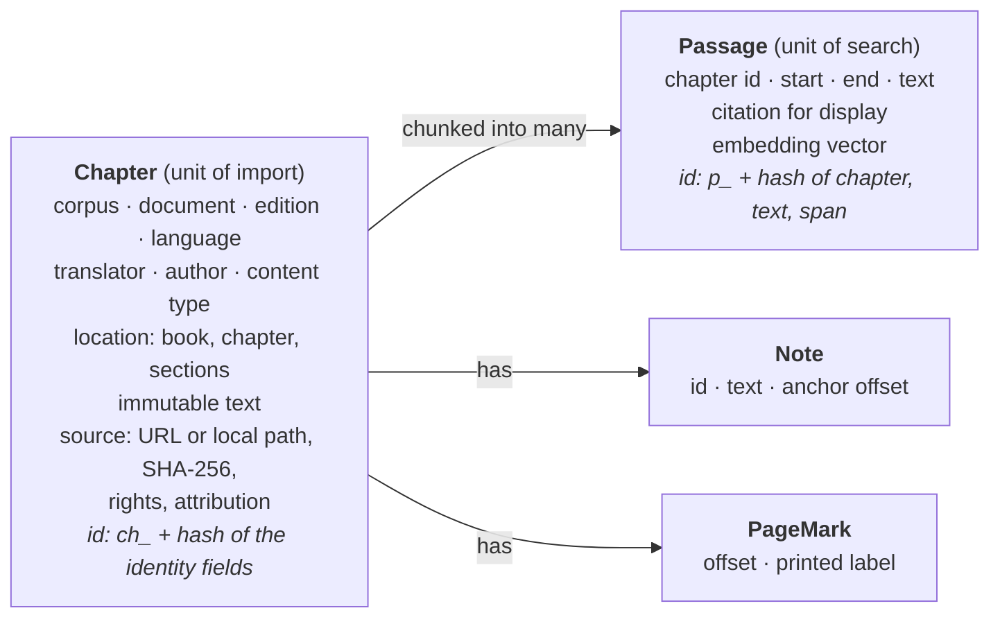
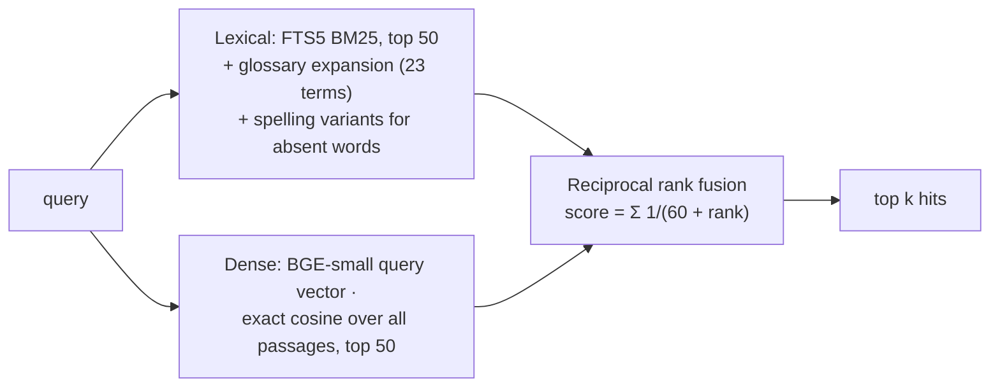

# Architecture

How Pramana is put together: the data it keeps, how texts enter it, how a question
becomes a grounded answer, and where each rule of the project is enforced. Written for
contributors; for setup see [your first run](../guides/first-run.md), for behaviour as a
user sees it see [chat and answers](../guides/chat.md).

## Contents

- [The system at a glance](#the-system-at-a-glance)
- [Repository map](#repository-map)
- [Data model and identities](#data-model-and-identities)
- [Ingestion: from a source to records](#ingestion-from-a-source-to-records)
- [Storage](#storage)
- [Indexing: chunks and vectors](#indexing-chunks-and-vectors)
- [Retrieval](#retrieval)
- [Answering a question](#answering-a-question)
- [Answer providers](#answer-providers)
- [HTTP API](#http-api)
- [Web application](#web-application)
- [Study-view services](#study-view-services)
- [Hosted mode (spike)](#hosted-mode-spike)
- [Evaluation and benchmarks](#evaluation-and-benchmarks)
- [Invariants and where they are enforced](#invariants-and-where-they-are-enforced)
- [Concurrency and performance](#concurrency-and-performance)
- [Extending Pramana](#extending-pramana)
- [Known limits](#known-limits)

## The system at a glance

Pramana is one Python package with three faces (library, CLI, FastAPI server) and a
React reader compiled into it. Everything runs on one machine: a SQLite file holds the
texts, passages, vectors and full-text index; a small embedding model runs on the CPU;
answers come from a local Ollama model or, when chosen explicitly, a free OpenRouter
model.



Two halves can be used apart: **retrieval** (search, the Study view, citations, notes)
needs only the library and the embedding model; **answering** adds a generation model.

## Repository map

| Path | What it holds |
| --- | --- |
| [`src/pramana/models.py`](../../src/pramana/models.py) | Pydantic records: `Chapter`, `Passage`, `Note`, `PageMark`, `Source`, `Citation`, chat request/response types |
| [`src/pramana/corpus.py`](../../src/pramana/corpus.py) | `Corpus`: import JSONL, build the index |
| [`src/pramana/storage.py`](../../src/pramana/storage.py) | `Store`: the SQLite schema and reads; readiness status |
| [`src/pramana/chunking.py`](../../src/pramana/chunking.py) | Tokenizer-aligned passages over immutable chapter text |
| [`src/pramana/embeddings.py`](../../src/pramana/embeddings.py) | The pinned BGE-small model: explicit setup, offline use |
| [`src/pramana/retrieval.py`](../../src/pramana/retrieval.py) | `Retriever`: lexical, dense and hybrid search, filters, spelling variants |
| [`src/pramana/answering.py`](../../src/pramana/answering.py) | `Answerer` and providers: routing, document selection, evidence, validation, claim check |
| [`src/pramana/discourse.py`](../../src/pramana/discourse.py) | Objection/reply roles from printed cues |
| [`src/pramana/glossary.py`](../../src/pramana/glossary.py), `glossary.json` | 110 Advaita terms; search expansion for 23 |
| [`src/pramana/library.py`](../../src/pramana/library.py), `paths.json` | Catalogue, categories, scopes, side-by-side sūtras, concepts, reading paths |
| [`src/pramana/citations.py`](../../src/pramana/citations.py) | Printed scripture references resolved and checked |
| [`src/pramana/evaluation.py`](../../src/pramana/evaluation.py) | Chapter, passage and answer benchmarks |
| [`src/pramana/hosted.py`](../../src/pramana/hosted.py) | Hosted-mode guards (Turnstile, atomic daily admission); not deployed |
| [`src/pramana/api.py`](../../src/pramana/api.py), [`cli.py`](../../src/pramana/cli.py) | FastAPI app and Typer CLI |
| [`src/pramana/ingestion/`](../../src/pramana/ingestion/) | Source adapters and their pinned manifests |
| [`web/src/`](../../web/src/) | React/TypeScript app: `chat/`, `study/`, `components/`, `lib/` |
| [`benchmarks/`](../../benchmarks/) | Datasets and committed results |
| [`scripts/`](../../scripts/) | Charts, HTML report, model comparison, manifest builders, link check |
| [`tests/`](../../tests/) | Deterministic tests (no network, books or models); `-m model` acceptance tests |

## Data model and identities



- **A chapter is the unit of import** and keeps its text unchanged once stored. Its
  identity comes from *where it is* (corpus, document, edition, language, printed
  location), not from its text, so a corrected re-import replaces the same record and
  different editions never collide.
- **A passage is a slice** `chapter.text[start:end]`; its identity also covers the text
  digest and the span, so re-chunking or a changed text produces new passage IDs.
- **Offsets are Python code points, `[start, end)`**, everywhere: passages, notes, page
  marks, objection/reply roles, benchmark gold spans, citations, Study selections and
  notes. The browser converts once, in [`web/src/lib/offsets.ts`](../../web/src/lib/offsets.ts)
  (code points to and from UTF-16), tested with characters outside the BMP.
- **Provenance travels with the text**: every chapter's `source` names exactly one
  origin (a URL, or a local path for private books), the retrieval time, the SHA-256 of
  what was fetched, the rights statement and attribution. The contract is in the
  [import format](import-format.md).

## Ingestion: from a source to records

Acquisition is always an explicit command (`pramana corpus download --source …`). Each
adapter fetches, validates against a committed manifest, and writes a
`chapters.jsonl` with receipts under `PRAMANA_HOME/corpora/<corpus>/`.

| Adapter | Sources | Pins and checks |
| --- | --- | --- |
| [`vishnu.py`](../../src/pramana/ingestion/vishnu.py) | Wilson's Vishnu Purana | SHA-256 of the archive in its receipt; chapters from `vishnu-manifest.json` |
| [`brahmasutra.py`](../../src/pramana/ingestion/brahmasutra.py) | Thibaut's Śaṅkara and Rāmānuja (Sacred Texts HTML, 1,123 pages) | per-page SHA-256 and sūtra identity in `*-manifest.json`; page marks and footnotes kept |
| [`sacredtexts.py`](../../src/pramana/ingestion/sacredtexts.py) | SBE Upaniṣads, Gītā, minor Upaniṣads, select works, Barnett, Crest-Jewel | section count and checksum per book (`sacredtexts/*.json`); plain-text and HTML modes |
| [`gutenberg.py`](../../src/pramana/ingestion/gutenberg.py) | Mitra's Yoga Vāsiṣṭha (7 volumes) | SHA-256 per volume, chapter counts per book; printed page numbers become page marks |
| [`textfile.py`](../../src/pramana/ingestion/textfile.py) | Aṣṭāvakra Gītā | SHA-256, rights quote, chapter and verse counts |
| [`pdf.py`](../../src/pramana/ingestion/pdf.py) | Three private PDFs (Tesseract); Madhavananda's Vivekacūḍāmaṇi (Chandra) | PDF checksum; per-page OCR cache; coverage report |

Rules the adapters share:

- **Fail closed.** A file that differs from its pin, or a structure that does not match
  the manifest (chapter count, heading sequence), stops the import rather than guessing.
- **Publish atomically.** Outputs are written to a temporary file and renamed, so an
  interrupted run never leaves a half-written `chapters.jsonl` or receipt.
- **Cleanup is documented, raw is kept.** OCR keeps raw output per page beside the
  cleaned text. For Chandra pages the cleanup is versioned (`CHANDRA_CLEANUP`): a newer
  cleanup recomputes text from the cached raw OCR without running OCR again. Cache keys
  include the PDF checksum and the OCR configuration; fields added later are left out
  of the key at their defaults so existing caches stay valid.
- **No guessing.** Division boundaries, verse references and missing OCR words are
  never inferred; printed numbers that contradict each other are recorded as positions
  with the printed label kept (the Yoga Vāsiṣṭha's misnumbered chapters).

`pramana ingest FILE` validates every record, then upserts in one transaction. Unchanged
records are skipped (a repeated import reports 0 changes); any change bumps the store's
`generation`, which marks the index stale.

## Storage

One SQLite file, `PRAMANA_HOME/pramana.sqlite3` (default `.pramana/`):

| Table | Contents |
| --- | --- |
| `meta` | `generation` (bumped by imports), `indexed_generation`, `index_config` (schema, chunking, embedding model and revision) |
| `chapters` | indexed columns for filtering (corpus, book, chapter, edition, language, translator) plus the full record as JSON |
| `passages` | passage JSON and its embedding as a float32 BLOB |
| `passages_fts` | FTS5 over passage text, `unicode61 remove_diacritics 2` (so *Śaṅkara* matches *Sankara*) |
| `passages_vocab` | `fts5vocab` row view, used to find which query words are absent from the index |

`Store.status()` reports one of `empty`, `stale` (imports newer than the index),
`incompatible` (schema or chunking changed: rebuild needed) and `ready`; search and the
CLI refuse to run against anything but `ready`.

## Indexing: chunks and vectors

`pramana index` ([`Corpus.index`](../../src/pramana/corpus.py)):

1. Checks the stored `index_config` against the current one; a different model,
   revision or chunking requires an explicit `--rebuild`.
2. Chunks every chapter ([`chunking.py`](../../src/pramana/chunking.py)): the embedding
   model's tokenizer maps tokens to character offsets; passages target 384 tokens, never
   exceed 448, overlap by 48, and prefer to end at a sentence or paragraph boundary. Text
   is sliced, never rewritten.
3. Embeds the passages with the pinned `BAAI/bge-small-en-v1.5` revision on the CPU
   (normalized float32, 384 dimensions); queries add BGE's retrieval prompt.
4. Replaces passages, vectors and the FTS index in one transaction, and only if no
   import happened meanwhile. A failed run leaves the previous index usable.

Measured: about 6.5 minutes for 8,851 passages on a 16-thread CPU.

## Retrieval

[`Retriever.search`](../../src/pramana/retrieval.py) takes a query, a strategy and
filters (`corpus_id`, `document_id`, `document_ids`, `author`, edition fields):



- **Lexical.** Words are folded (diacritics removed). Query words that occur in fewer
  than two passages borrow indexed spellings with the same phonetic key (k/c/ch/kh,
  aspirates, doubled vowels: *Naciketas* finds *Nakiketas*); author names are never
  varied.
- **Dense.** An exact scan with NumPy over every vector in the filtered set: at about
  nine thousand passages an approximate index would add complexity without a speed
  problem to solve.
- **Hybrid** (the chat default) fuses both 50-deep lists with equal weights; a tuning
  grid on the dev split gave no gain, so none is applied.
- **Scope.** [`library.py`](../../src/pramana/library.py) groups documents into
  categories by title. Chat scopes (`upanishads`, `gita`, `yoga-vasistha`, `shankara`,
  `ramanuja`) resolve to document IDs. The Yoga Vāsiṣṭha is **opt-in**: "All texts"
  leaves it out unless named or chosen, because it is larger than the rest of the
  library together and measurably crowds results.

Relevance scores are ranking signals only; they are never shown as confidence.

## Answering a question

[`Answerer.answer`](../../src/pramana/answering.py) turns a `ChatRequest` into a
validated `ChatResponse`. The streaming endpoint reports the stages as they happen.

```mermaid
sequenceDiagram
    participant U as Chat UI
    participant A as Answerer
    participant P as Provider
    participant R as Retriever
    U->>A: message, history, scope, depth, mode, check, focus?
    opt follow-up (history present)
        A->>P: rewrite to a standalone question (+ edition IDs)
    end
    opt no selected passage
        A->>P: route: "texts" or "unrelated"?
        P-->>A: unrelated → fixed reply, nothing retrieved
    end
    A->>A: choose documents: scope, opt-in, named works, named thinkers
    A->>R: retrieve (balanced per edition / per thinker when named)
    A->>A: evidence: selected passages first, roles, byte budget
    A->>P: draft answer (JSON schema: answer, status, evidence_ids, perspectives?, questions?)
    A->>A: validate references, status, authorship, display rules
    opt invalid
        A->>P: one repair attempt (budget re-applied)
    end
    opt check on
        A->>P: per-thinker sentence verdicts; drop unsupported
    end
    A-->>U: answer, status, evidence pointers, perspectives
```

Step by step:

1. **Follow-ups** are rewritten into a standalone retrieval question from bounded recent
   history (pairs only, 3,000 bytes); previous answers are never evidence.
2. **Routing.** One short call decides whether the question is about the texts at all,
   with six worked examples as conversation turns. "Unrelated" returns the fixed reply
   ("Neti, neti…") without retrieval. An invalid routing reply counts as on-topic.
   Questions about a passage selected in Study skip routing.
3. **Document selection.** The scope restricts documents; a named edition or work
   ("Katha Upanishad", "Chinmayananda") is searched itself; naming two or more thinkers
   makes the question a comparison and retrieves each thinker's own editions
   separately, with thinker names dropped from that search text.
4. **Retrieval** returns up to eight passages, interleaved across requested editions or
   thinkers. A **focus** (an "Ask about this passage" selection) puts the indexed
   passages covering the selection first, marked `selected`.
5. **Evidence.** Each passage goes to the model with its work, edition, author,
   translator and content type, split into `objection` / `reply` / `unmarked` segments
   where the book prints a cue ([`discourse.py`](../../src/pramana/discourse.py)). The
   request is kept under 13,800 bytes by dropping the lowest-ranked passages, before
   every attempt.
6. **Draft.** The model answers to a JSON schema built per request: `evidence_ids` is
   an enum of the supplied references; comparisons require `perspectives`, each
   `thinker` restricted to authors present; vichāra mode requires reflective
   `questions`.
7. **Validation.** References must exist; grounded answers need evidence and
   insufficient ones must have none; each perspective may cite only its own thinker's
   passages; prose may not contain internal references, URLs, source lists or page
   numbers. One bounded repair is allowed; then the request fails with a readable
   error rather than an invented reference.
8. **Optional check** sends each sentence back with the same evidence (per thinker for
   comparisons) and removes sentences judged unsupported. It is the same model judging
   itself, not verification.

What the UI receives includes `evidence` (passage pointers for the Study view) and
`perspectives`; the chat renders only the prose and one "Read in the texts" link.

## Answer providers

Both implement `AnswerProvider` (`model` and `async chat(messages, schema) -> dict`)
and are chosen by `PRAMANA_PROVIDER`:

| Provider | When | Notes |
| --- | --- | --- |
| `OllamaProvider` (default) | local GPU or CPU | `POST /api/chat`, JSON-schema `format`, temperature 0, 16k context, no model pulls |
| `OpenRouterProvider` | `PRAMANA_PROVIDER=openrouter` + `OPENROUTER_API_KEY` | `:free` model IDs only; `response_format` JSON schema with `require_parameters`; rate limits mapped to plain errors |

A provider marked `hosted` never receives private local editions: the Answerer drops
their passages from evidence, their titles from the rewrite catalogue, and refuses a
selection from them. Retrieval and embeddings stay local with either provider.

## HTTP API

FastAPI in [`api.py`](../../src/pramana/api.py), bound to localhost; full field
reference in the [API reference](api.md).

| Area | Endpoints |
| --- | --- |
| Status and config | `GET /api/status`, `GET /api/config` (hosted flag, provider name and model) |
| Search | `POST /api/search` |
| Chat | `POST /api/chat`, `POST /api/chat/stream` (NDJSON stages, then the answer) |
| Reader | `GET /api/chapters/{id}` (text, roles, neighbours), `GET /api/library`, `GET /api/glossary` |
| Study | `GET /api/parallel`, `GET /api/concepts`, `GET /api/concepts/{key}`, `GET /api/paths`, `GET /api/scopes`, `GET /api/citations`, `GET /api/citations/{chapter_id}` |
| App | `GET /` and `/assets/*` serve the compiled reader |

Chat requests run one at a time (`asyncio.Semaphore(1)`), and searches, including
those made by chat, take one shared lock, so a single local model and embedder serve one
request at a time.

## Web application

React and TypeScript, built by Vite into `src/pramana/static/` (git-ignored) and served
by FastAPI, so the wheel contains the whole app. Hash routes keep one `index.html`:

| Route | Component | Shows |
| --- | --- | --- |
| `#/` | [`chat/Chat.tsx`](../../web/src/chat/Chat.tsx) | conversation only: answers, per-thinker cards, one "Read in the texts" link |
| `#/study` | `study/Study.tsx` (Library) | works by category, actions |
| `#/study/read/{chapter}?s=&e=` | Reader + [`ChapterText.tsx`](../../web/src/study/ChapterText.tsx) | text with page marks, notes, roles, citation links, "cited by", user highlights; the span highlighted |
| `#/study/sutra/{a}/{p}/{s}` | Parallel | Śaṅkara and Rāmānuja side by side |
| `#/study/evidence/{turn}` | Evidence | the passages behind one answer |
| `#/study/concept/{slug}`, `#/study/paths`, `#/study/search` | Concept, Paths, Search | glossary concepts, reading paths, search |
| `#/study/citations`, `#/study/notes` | [`Citations.tsx`](../../web/src/study/Citations.tsx), [`Notes.tsx`](../../web/src/study/Notes.tsx) | most-cited śruti; the reader's own notes |

Browser storage, by purpose:

| Store | Key | Holds | Lifetime |
| --- | --- | --- | --- |
| `sessionStorage` | `pramana.conversation.v1` | turns with evidence pointers | this tab; New chat clears it |
| `sessionStorage` | `pramana.focus.v1` | a pending "Ask about this" pointer | taken once by the chat |
| `localStorage` | preferences, reading-path progress | display settings | this browser |
| `localStorage` | `pramana.notes.v1` | highlights and notes with their quoted words | this browser; exported only by the user |

Nothing is stored server-side; there are no accounts.

## Study-view services

- **Catalogue and categories** ([`library.py`](../../src/pramana/library.py)): documents
  with their divisions in reading order; categories are display groupings by title.
- **Side by side**: matches the two Brahma Sūtra commentaries on printed adhyāya, pāda
  and sūtra; a page beginning at an earlier sūtra is returned as `exact: false`.
- **Concepts**: phrase search on each glossary term's names, grouped by text family.
- **Citations** ([`citations.py`](../../src/pramana/citations.py)): one pass over all
  chapters parses printed references, maps abbreviations to editions and numbers to
  printed divisions, and checks each against the quoted words (consecutive word pairs).
  The forward and reverse indexes are cached per library `generation` (under a second
  to rebuild).
- **Notes** are entirely client-side ([`web/src/lib/notes.ts`](../../web/src/lib/notes.ts)).

## Hosted mode (spike)

[`hosted.py`](../../src/pramana/hosted.py) is a local prototype of what a public site
would need before any model call: a fail-closed Cloudflare Turnstile check and an
atomic admission transaction in SQLite (global, per-visitor and per-minute limits,
request-ID idempotency, a pause switch), with visitors identified only by an HMAC of
the address under a daily key. `create_app(hosted=...)` enables it; nothing is
deployed. The plan is in [hosted deployment](../plans/hosted-deployment.md).

## Evaluation and benchmarks

| Piece | Where |
| --- | --- |
| Chapter benchmark (Vishnu Purana, edition-aware) | `evaluate`, `benchmarks/questions.json` |
| Passage benchmark: gold spans, splits, per type/text/origin, failure analysis | `evaluate_passages`, `benchmarks/advaita/` (v1) and `v2/` |
| Answer benchmark with a real model: status, gold cited, attribution, latency; resumable batches | `evaluate_answers`, `pramana evaluate-answers` |
| Routing alone | `evaluate_routing`, `--route-only` |
| Embedding models in isolated library copies | `scripts/compare_embeddings.py` |
| Charts and HTML report from the result files | `scripts/plot_benchmarks.py`, `scripts/benchmark_report.py` |

Gold spans resolve against one exact chapter and must still equal their quote, so a
changed edition makes the evaluator refuse the dataset instead of scoring it. A
retrieved passage counts only if it contains the whole span.

## Invariants and where they are enforced

| Rule (from [AGENTS.md](../../AGENTS.md)) | Enforced in |
| --- | --- |
| Canonical text is immutable; offsets are code points | `models.py` offset validators, `chunking.py` slicing, `offsets.ts` conversions and tests |
| Every record carries origin, checksum, rights, attribution | `Source` validator; adapters' manifests and receipts |
| Different editions stay separate | chapter identity includes edition; evaluator matches edition |
| Fresh evidence for every question, follow-ups included | `Answerer.answer` always retrieves; history is never evidence |
| References validated against supplied passages | schema enums and validation in `Answerer.answer` |
| A thinker's view cites only that thinker | perspective author check before display |
| Chat shows no sources, excerpts, IDs or scores | `display_answer`, response shaping; UI renders prose only |
| Study never shows E1 references or scores | API returns pointers, not model references; UI omits scores |
| Objection/reply only from explicit cues | `discourse.py` markers and phrases |
| No silent downloads or provider switches; private text never sent to a hosted service | explicit `model setup` / `corpus download`; `PRAMANA_PROVIDER`; hosted privacy guard in `Answerer` |
| A failed index never replaces a usable one | generation check and single transaction in `Corpus.index` |

## Concurrency and performance

Measured on the reference machine (16-thread CPU, RTX 5070 Ti, 15 GB RAM):

| Operation | Time |
| --- | --- |
| Index 8,851 passages (CPU) | about 6.5 minutes |
| Search (warm): keyword / semantic / hybrid | about 30 / 65 / 80 ms |
| Routing call / full answer with `gemma4:e4b` | about 0.1 s / median 1.1 s |
| Citation index rebuild | under a second |
| Chandra OCR, 252 pages | 71 minutes |

With `gemma4:e4b` loaded, Ollama keeps about 6 GB of the model in system RAM besides the
GPU copy; on machines that swap to zram, unloading it between long batch runs
(`ollama stop`) keeps memory free.

## Extending Pramana

**A new source.** Write an adapter under `ingestion/` that fetches explicitly, pins
what it fetches (SHA-256 and structure counts in a committed manifest), emits records
in the [import format](import-format.md), and publishes atomically. Add a `SOURCES`
entry in `cli.py`, a notice in [sources](../notices/sources.md), tests with a synthetic
fixture (structure changes, checksum mismatch, re-import idempotency), and re-run the
benchmarks to see whether it crowds retrieval (as the Yoga Vāsiṣṭha did).

**A new answer provider.** Implement `AnswerProvider`; mark it `hosted = True` if it
leaves the machine (the privacy guard then applies); select it only through
`PRAMANA_PROVIDER`; map its errors to `AnswerError` with plain messages; test with a
mocked transport; measure with `pramana evaluate-answers` before recommending it.

**A new Study feature.** Add an endpoint returning code-point offsets and pointers,
never model references or scores; render through `ChapterText` so offsets are
converted in one place; keep anything personal in the browser.

**A retrieval change.** Change one thing, run the dev split only, and keep the heldout
split for confirmation; record results, including changes that did not help, in the
benchmark READMEs.

## Known limits

- Answers are checked for structure and attribution, not truth; the model can misread
  an argument, especially a rival view restated without a printed cue.
- The benchmark questions were drafted by an AI model and are unreviewed.
- Retrieval scores single gold passages; a relevant passage from another text counts
  as a miss.
- Dense search scans every vector; fine at this size, not for a library a hundred times
  larger.
- Hosted mode is a prototype; nothing is deployed.
