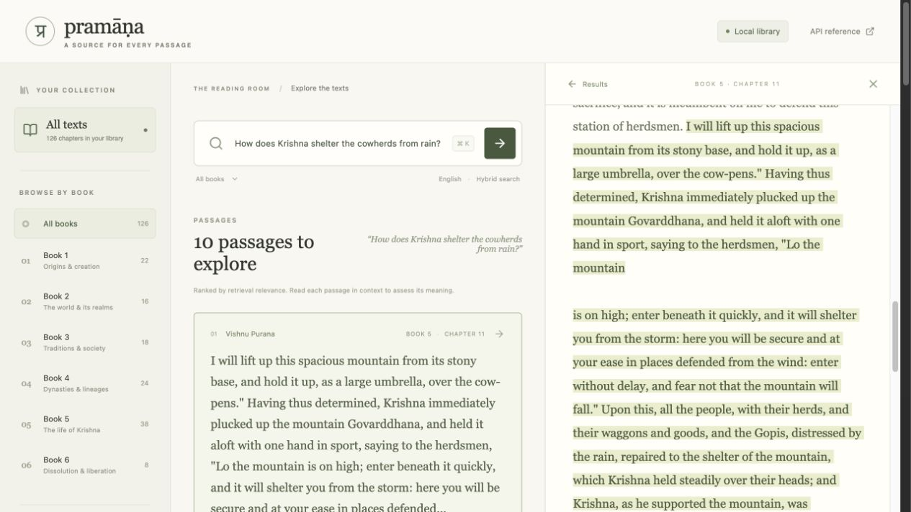

# Local verification — 14 October 2026

- Python 3.12.15; Node 26.11.1; macOS arm64.
- `uv sync --locked --offline`: passed using the prepared dependency cache.
- Ruff lint and format checks: passed.
- Deterministic pytest suite: **26 passed**, no model or network required.
- Actual-model acceptance suite with Hugging Face/Transformers offline flags:
  **2 passed**, including the complete manifest and every stored citation offset.
- TypeScript checking and Vite production build: passed.
- Source distribution and wheel: built; every packaged UI asset compared byte-for-byte
  with the final frontend build.
- Fresh source-distribution directory: locked dependency install, `npm ci`, frontend
  build, cached-source parsing, 126-chapter ingestion, offline indexing, and CLI search
  all passed. The already-downloaded model was reused; network acquisition was tested
  separately rather than repeated.
- Actual source archive: 126 chapters across six books, 587 indexed passages.
- Twenty-question benchmark: results and methodology in [benchmarks](../benchmarks/README.md).
- Browser: hybrid search, filtered mobile search, chapter context, source highlighting,
  note links, copy-to-clipboard, Escape, result arrow navigation, and desktop/mobile
  layouts checked. No browser console errors observed. Mobile viewport: 390 × 844;
  viewport restored afterward.

The source archive returned a browser challenge to automated requests in this
environment. The official **Text [Zipped]** download was acquired through a normal
browser session and imported using `--archive`. This fallback is documented in the
quickstart. No challenge was bypassed. Model setup succeeded directly from the Hub.

The test server is temporary. Run `uv run pramana serve` from the repository to
start the prepared library at [localhost:8000](http://127.0.0.1:8000).

