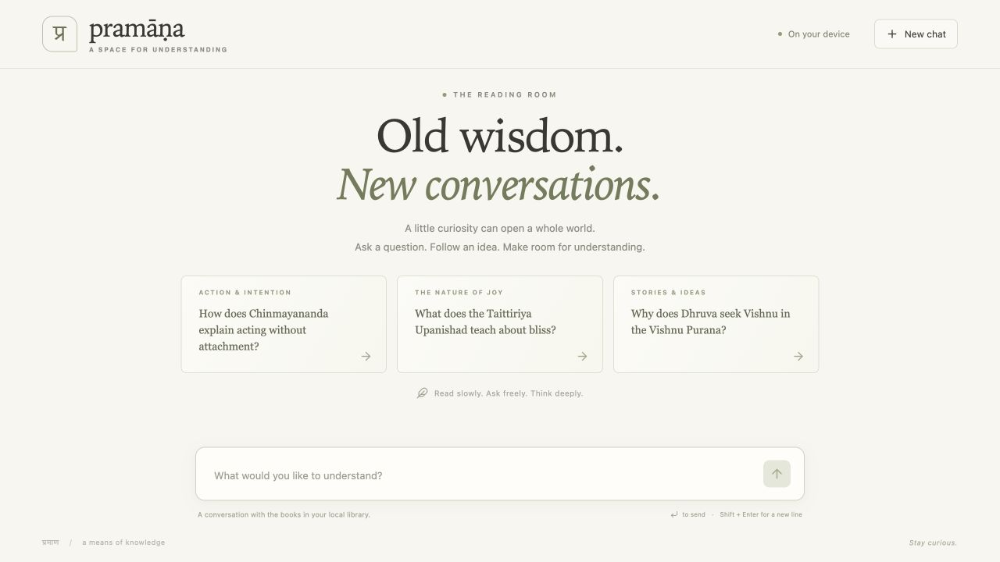
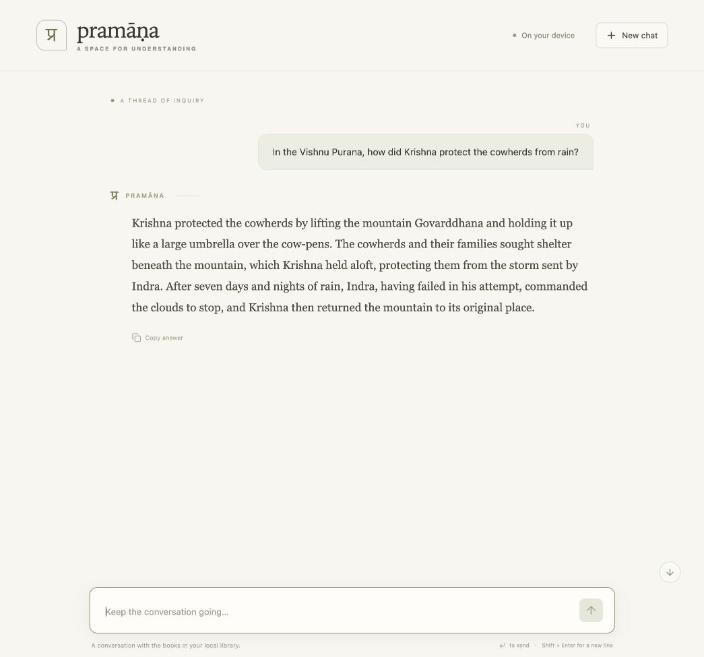

# Book-aware chat verification — 14 October 2026

Local environment: macOS arm64, Python 3.12.15, Node 26.11.1. The
[historical v0.1 verification](verification-baseline-v0.1.md) is retained separately.

## Local library and extraction

| Private edition                         | Physical pages | Extracted | Blank | Questionable | Indexed page records |
| --------------------------------------- | -------------: | --------: | ----: | -----------: | -------------------: |
| Chinmayananda, Holy Geeta               |          1,358 |     1,357 |     0 |            1 |                1,357 |
| Shankara Gita / Alladi Mahadeva Sastry  |            538 |       534 |     0 |            4 |                  522 |
| Taittiriya Book II / A. Mahadeva Sastri |            324 |       315 |     7 |            2 |                  308 |

Quality categories describe all physical pages; indexing separately excludes front
matter, short/blank pages, and the Taittiriya contents insert at pages 10–16.
One questionable Shankara page (physical page 27) remains indexed. Quality flags
are extraction heuristics, not editorial certification. All originals were moved
to `.pramana/sources/pdfs/` with SHA-256 checks before/after preservation. The saved
files were checked again against their acquisition/coverage records. Repeated
imports reported **zero changed pages for all three editions**.

Together with Wilson's 126 chapters / 587 passages, the prepared library contains
**2,313 chapter/page records and 3,367 passages**. Index schema 2 records the pinned
BGE revision and existing 384/448/48 chunk settings. Offline rebuild/search uses
local weights. Every stored passage was checked against its exact canonical text
slice, token limit, citation origin, and commentary attribution.

Representative source review included PDF title pages; English extraction from
both Gita editions; Taittiriya physical pages 1–6 rendered for scan/title/coverage
inspection; and physical page 50 rendered to confirm the knowledge/liberation
passage against OCR. Additional OCR samples at pages 50, 100, 200, and 300 were
inspected. This is sample review, **not a correction of every page**. OCR can retain
broken words, Sanskrit rendered as Latin noise, page headings, punctuation errors,
and footnotes mixed into the main flow. Physical PDF pages are retained internally;
no textual chapter/verse mapping is asserted. See [the PDF guide](../guides/pdf-ingestion.md).

## Checks

- Locked dependency synchronization with the prepared local cache: passed.
- Ruff lint/format checks and **61 deterministic tests**: passed. These use fake
  embeddings/providers, synthetic PDFs, and mocked OCR without books or services.
- **Two actual embedding-model tests** with offline flags: passed, including all
  126 manifest chapters and all 3,367 stored passage/citation offsets.
- TypeScript checking and Vite production build: passed; fonts/assets need no
  external web service.
- Source distribution/wheel built after frontend compilation; packaged assets
  matched the build byte-for-byte. Neither package contains PDFs, private full
  text, library databases, or model weights.
- Installed wheel checked from `/private/tmp`: compiled homepage/assets, empty
  library status, chat/search setup errors, and missing context behavior passed.
  This local isolated-wheel check reused prepared dependencies. A completely fresh
  dependency resolution was not repeated; CI now installs wheel dependencies in
  a separate environment before the same check.
- The new GitHub workflow has **not been run for these uncommitted changes**.
  The successful historical CI run remains linked in the roadmap.

## Retrieval and answers

The existing 20-question chapter benchmark was migrated to explicit source
identities and rerun, filtered to Wilson's exact edition:

| Method  | Recall@10 | MRR@10 |
| ------- | --------: | -----: |
| Lexical |    95.00% | 0.7583 |
| Dense   |   100.00% | 0.8026 |
| Hybrid  |   100.00% | 0.8306 |

This is an initial engineering benchmark. Added books change global FTS statistics;
these differences from the historical run do not demonstrate tuned retrieval gains.
The benchmark does not score passage support or answer quality. Source identities,
checksums, index configuration and per-question results are in
[results.json](../../benchmarks/results.json).

All eight real-model requests completed with expected status and source membership,
but the comparison answer contains a documented objection/reply interpretation error.
These structural checks must not be described as eight factually correct answers.
Real local-answer diagnostics and interpretation review are recorded in
[chat validation](chat-validation.md). Full answers/evidence remain private under
`.pramana/chat-smoke.json`; published question metadata contains no private book text.

## Browser workflow

A deterministic fixture server (`uv run python tests/manual_chat_server.py`) was
used to check suggested questions, follow-ups, Enter/Shift+Enter, focus behavior,
Unicode including supplementary characters, answer copying, pending/Stop, model
failure/retry, reload persistence, interrupted reload recovery, and reset followed
by reload. Desktop and 390 × 844 mobile layouts had no horizontal overflow; the
composer remained visible. No source controls or hidden provenance fields appeared
in the rendered conversation. Observed browser console warnings/errors: none.
These are local browser checks; automated browser CI remains roadmap work.

The actual Ollama model also answered the Wilson rain/Govarddhana question through
the final web interface. The answer survived reload and displayed without citation
markers or source metadata. Desktop and mobile screenshots were saved; the
viewport override was reset. Temporary preview servers are stopped after checking.
Start the prepared app with `uv run pramana serve` and open
[localhost:8000](http://127.0.0.1:8000).

## Benchmark v2, Madhavananda's Vivekacūḍāmaṇi and off-topic routing — 23 October 2026

Library: 13 editions, 2,639 chapters, 8,851 passages, after importing Madhavananda's
Vivekacūḍāmaṇi (Chandra OCR, 252 pages in 71 minutes on an RTX 5070 Ti) and moving
the Yoga Vāsiṣṭha's inline page numbers into page marks. Re-importing either changed
nothing. Results: [benchmark v2](../../benchmarks/advaita/v2/README.md); v1 numbers
re-measured in [benchmarks/advaita](../../benchmarks/advaita/README.md).

Manual checks with Ollama `gemma4:e4b`, diagnostic only:

| Question | Outcome |
| --- | --- |
| Madhavananda's Vivekacūḍāmaṇi: what three things are rare? | Grounded in that edition's PDF page 10 |
| "Can you reverse a linked list?", "reverse a linked list", "What is the duty of a software engineer?", "Write a Python function that reverses a list." | **Before:** all four answered from unrelated passages (Brahman's reabsorption in reverse order; svadharma). A topic field inside the answer schema did not change that. **After** the routing call: all four declined. |
| "What is the boiling point of water…?" | Insufficient evidence before and after |
| Śaṅkara on superimposition; the Gītā on duty; applying the Gītā's duty to an engineer's work; Aṣṭāvakra on bondage; whether the Self is born | Grounded before and after; not routed away |

The routing prompt was chosen among four variants by their results on the v2 questions
(a field classifier sent nearly everything, Kubernetes included, to "other religion or
philosophy"; a version listing the library's titles turned away 39 real questions).
Two of its worked examples are the questions reported above, so those two are not a
test of it. Five further questions written afterwards ("How do I center a div in
CSS?", "What's the best laptop for coding?", "Explain quicksort", "Is the world real?",
"How do I deal with anger?") routed as expected. The full answer-level run (`pramana evaluate-answers`, 214 questions, about 6 minutes
of answering in batches) is in [benchmark v2](../../benchmarks/advaita/v2/README.md):
expected outcome 0.93, all 16 out-of-corpus questions declined, gold cited 0.66.
During it, Ollama's runner held about 4 GB in RAM and 4 GB in zram (compressed swap in
RAM); unloading the model between batches (`ollama stop`) kept about 11 GB free. One
earlier attempt was killed mid-run and recorded 8 "Cannot reach Ollama" failures as
answers; the harness now stops on an outage instead, and those 8 were re-run.

## Vedānta library and comparisons — 23 October 2026

Library: every `--source advaita` edition plus Wilson, imported from the cached
downloads and indexed with the pinned BGE-small model (1,677 chapters, 4,352 passages;
indexing took about 3 minutes on CPU). Benchmarks are reported in
[benchmarks/advaita](../../benchmarks/advaita/README.md#results-23-october-2026) and the
[chapter benchmark](../../benchmarks/README.md#run-of-23-october-2026).

A small manual session with Ollama `gemma4:e4b` (installed ID `dc35e8d9c606`) through
the HTTP API. This is diagnostic review of a handful of answers, not a measured
accuracy result:

| Question | Outcome after this session's fixes |
| --- | --- |
| How does Shankara define superimposition? | Grounded in BS I.1.1 (Śaṅkara's introduction); matches the "apparent presentation" definition and its examples. |
| Śaṅkara and Rāmānuja on the individual soul (Check on) | Both views attributed correctly: identity in essence vs. a real difference from the highest Self. |
| Kaṭha Upaniṣad on the Self (vichāra) | Answered from the Kaṭha itself, with three reflective questions. |
| Śaṅkara and Rāmānuja on whether the world is real (Check on) | **Before the fixes:** Rāmānuja's card stated the Advaita view he refutes, and Śaṅkara's card ended on the prima facie view of BS III.2.1; the authorship and claim checks passed both. **After:** with the corrected server running, one run attributed both views correctly; a later run was refused by the authorship validation instead of publishing a misattribution. |

Fixes made during the session, each covered by deterministic tests: the claim check
judges each thinker's statements only against that thinker's passages; author-filtered
comparison retrieval drops thinker names from the search text; the comparison prompt
describes unlabelled restatements of rival views; a named scriptural work (e.g. "Katha
Upanishad") restricts retrieval to that work; the lowest-ranked passages are trimmed
only when the whole request would exceed the provider budget (a longer prompt had
caused a 422); vichāra questions are required by the JSON schema.

**Open limitation:** commentators restate opposing positions at length without the
printed cues Pramana recognises (Rāmānuja's II.1.15 page is about 73,000 characters of
argument). Neither the authorship check nor the same-model claim check can tell such a
restatement from the author's own view. Doctrinal comparisons remain material for
review against the texts in the Study view. Browser checks of the new UI were not part
of this session.

After adding speaker-naming objection/reply cues, the world-reality comparison gave
correctly attributed views again (Check on, nothing removed). "How do Śaṅkara and
Rāmānuja differ on Nescience (avidyā)?" returned insufficient evidence: retrieval did
not surface Rāmānuja's "The theory of Nescience cannot be maintained" pages, a
retrieval-ranking limit recorded rather than tuned for.
